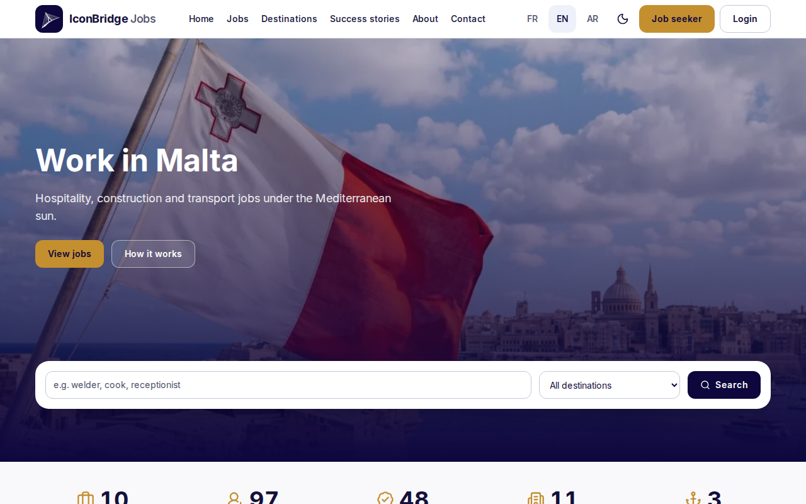
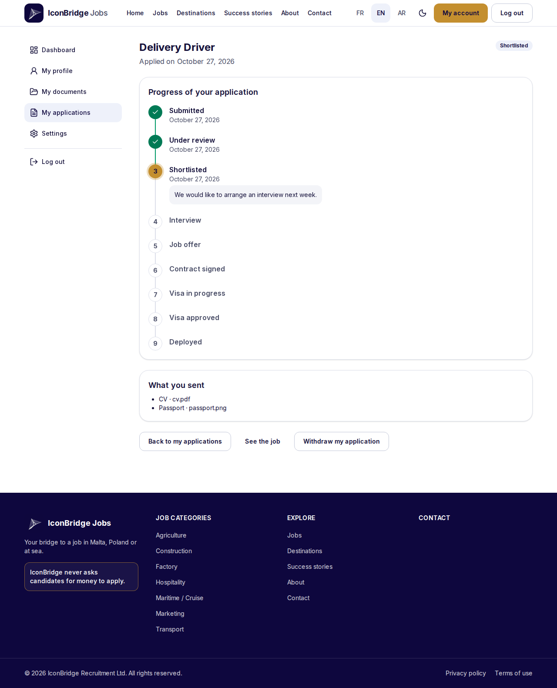
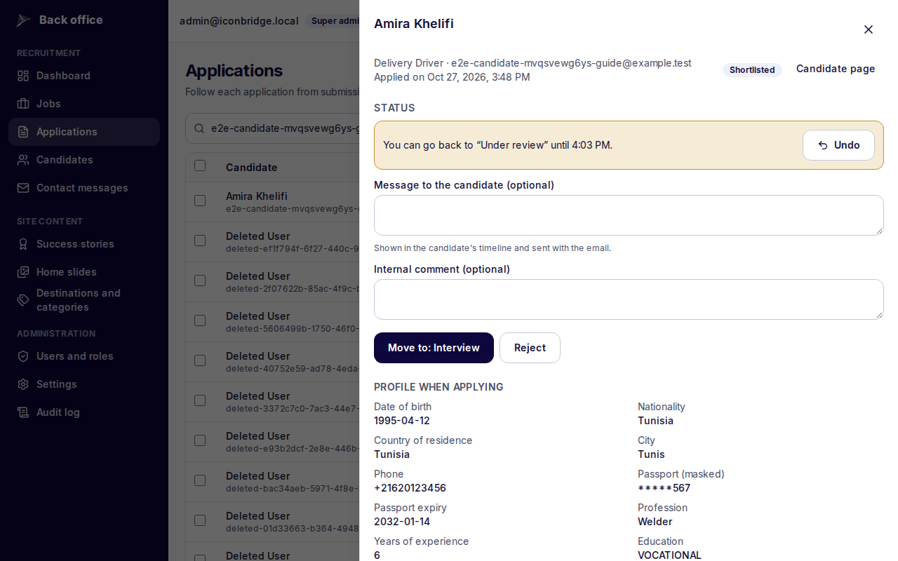

# IconBridge Jobs

[](https://github.com/hhhhhhhhhhhh4521515/iconbridge-platform/actions/workflows/ci.yml)
[](https://github.com/hhhhhhhhhhhh4521515/iconbridge-platform/actions/workflows/security.yml)
[](https://github.com/hhhhhhhhhhhh4521515/iconbridge-platform/actions/workflows/deploy.yml)
[](https://github.com/hhhhhhhhhhhh4521515/iconbridge-platform/actions/workflows/infra.yml)

Recruitment platform where candidates apply for jobs in Malta, Poland and on cruise ships. Candidates register, build a profile, upload their documents and apply; recruiters publish job offers and move each application through the visa pipeline, from submission to deployment.



| Candidate area                                                               | Back office                                                     |
| ---------------------------------------------------------------------------- | --------------------------------------------------------------- |
|  |  |

## Features

- Public site in English, French and Arabic (right to left): job search with filters, job pages, success stories, job alerts by email.
- Candidate area: profile wizard, private documents checked from their content, applications with a 6-month rule per job, a timeline of each application, data export and account deletion.
- Back office for viewers, recruiters and super admins: jobs with custom questions, applications as a table or a board, a 9-step visa pipeline with undo, internal notes, exports, audit log, historical figures.
- Security: encrypted passport numbers, HttpOnly cookies, CSRF origin check, rate limits, strict Content-Security-Policy, every route's access tested ([SECURITY.md](docs/SECURITY.md)).
- Production on Azure with Terraform, GitHub Actions with federated identities and approval, automatic rollback, Application Insights, alerts by email, weekly backups ([RUNBOOK.md](docs/RUNBOOK.md)).

## Stack

| Part           | Technology                                                                                                   |
| -------------- | ------------------------------------------------------------------------------------------------------------ |
| Web            | Next.js 16 (App Router), React 19, Tailwind CSS, shadcn/ui, next-intl                                        |
| API            | NestJS 12 (ESM), Prisma 7, PostgreSQL 16, zod schemas shared with the web app                                |
| Infrastructure | Azure Container Apps, PostgreSQL Flexible Server, Blob Storage, Key Vault, Communication Services; Terraform |
| Delivery       | GitHub Actions (OIDC, no stored Azure secret), Trivy, CodeQL, gitleaks, Dependabot                           |
| Tests          | Vitest (unit and API end-to-end), Playwright (Chromium, Firefox, WebKit, axe), k6                            |

## Quick start

Requirements: Node 22 (`nvm use`), pnpm through corepack, Docker running. Work inside WSL, not on a Windows drive.

```bash
pnpm install
pnpm env:init   # creates .env, apps/api/.env and apps/web/.env from the examples
pnpm dev        # compose services (PostgreSQL, Azurite, Mailpit) + web + api
pnpm db:seed    # in another terminal: reference data, sample jobs, local super admin
```

| URL                                  | What                                |
| ------------------------------------ | ----------------------------------- |
| <http://localhost:3000>              | Web app                             |
| <http://localhost:3000/en/admin>     | Back office                         |
| <http://localhost:4000/api/docs>     | Swagger UI                          |
| <http://localhost:4000/health/ready> | API readiness (checks the database) |
| <http://localhost:8025>              | Mailpit inbox                       |

| Command                                      | Effect                                                          |
| -------------------------------------------- | --------------------------------------------------------------- |
| `pnpm lint` / `pnpm typecheck` / `pnpm test` | ESLint, TypeScript, unit tests of every workspace               |
| `pnpm test:e2e`                              | API end-to-end tests against PostgreSQL (needs `pnpm infra:up`) |
| `pnpm test:browser`                          | Playwright tests (stop `pnpm dev` first)                        |
| `pnpm build`                                 | Build every workspace                                           |
| `pnpm api:types`                             | Regenerate the typed API client and [docs/API.md](docs/API.md)  |

Browser tests need Chromium and its system libraries once: `pnpm --filter @iconbridge/web exec playwright install chromium`, then `sudo pnpm --filter @iconbridge/web exec playwright install-deps chromium`. All commands and conventions: [CLAUDE.md](CLAUDE.md).

## Documentation

[docs/README.md](docs/README.md) maps every document to a chapter of the internship report. The main ones:

- [SPEC.md](docs/SPEC.md): functional specification
- [ARCHITECTURE.md](docs/ARCHITECTURE.md): C4 diagrams, data model, Azure deployment
- [API.md](docs/API.md): every operation and who may call it
- [USER-GUIDE-CANDIDATE.md](docs/USER-GUIDE-CANDIDATE.md) and [USER-GUIDE-ADMIN.md](docs/USER-GUIDE-ADMIN.md)
- [RUNBOOK.md](docs/RUNBOOK.md): operations, backups, alerts, end of life
- [adr/](docs/adr/README.md): 21 architecture decisions
- [TIMELINE.md](docs/TIMELINE.md) and [JOURNAL.md](docs/JOURNAL.md): how the project was built

Screenshots show test data only: the repository is public.
