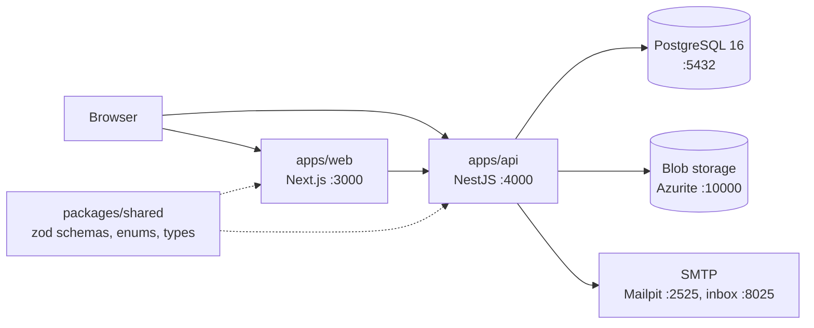
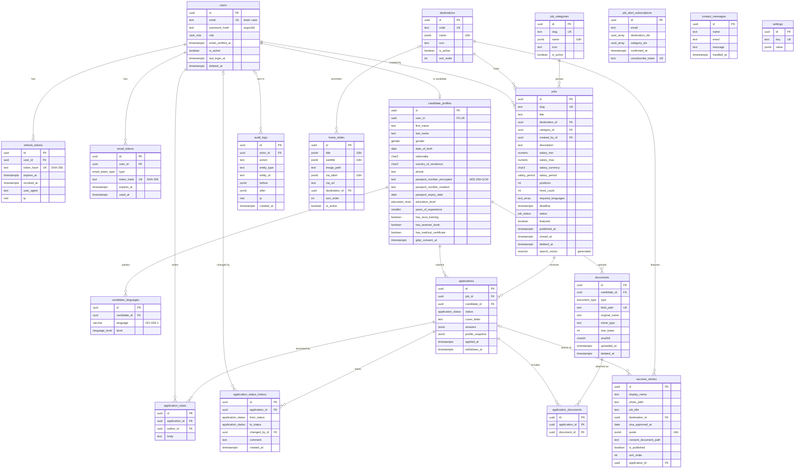

# Architecture

Current state of the repository. Feature scope is in [SPEC.md](SPEC.md); decisions are in [adr/](adr/).

## Overview

## Workspaces

| Path              | Package              | Role                                                        |
| ----------------- | -------------------- | ----------------------------------------------------------- |
| `apps/web`        | `@iconbridge/web`    | Next.js App Router, Tailwind CSS 4, shadcn/ui (RTL enabled) |
| `apps/api`        | `@iconbridge/api`    | NestJS 12 REST API (ESM), Prisma 7                          |
| `packages/shared` | `@iconbridge/shared` | zod schemas, enums and inferred types used by both apps     |
| `packages/config` | `@iconbridge/config` | ESLint, Prettier and tsconfig presets                       |
| `infra/terraform` | -                    | Azure infrastructure (empty for now)                        |

`packages/shared` is compiled to `dist/` (ESM + type declarations). Both apps import the compiled output, so it is built first; Turborepo handles the order.

## API

| URL             | Purpose                                                                                                 |
| --------------- | ------------------------------------------------------------------------------------------------------- |
| `/api/v1/*`     | Business endpoints (global prefix)                                                                      |
| `/api/docs`     | Swagger UI; OpenAPI JSON at `/api/docs-json`                                                            |
| `/health/live`  | Liveness: always 200 while the process runs                                                             |
| `/health/ready` | Readiness: 200 with `{"status":"ok","checks":{"database":"ok"}}`, 503 when the database does not answer |

The health endpoints are outside the `/api/v1` prefix so container probes keep a stable, unversioned path.

Structure of `apps/api/src`:

| File             | Role                                                                             |
| ---------------- | -------------------------------------------------------------------------------- |
| `main.ts`        | Starts the server                                                                |
| `app.setup.ts`   | Prefix, CORS, Swagger. Shared by `main.ts` and the e2e tests                     |
| `config/env.ts`  | zod schema of the environment; the app refuses to start if a variable is missing |
| `prisma/`        | `PrismaService` (global module), connects on first query                         |
| `common/crypto/` | Passport field encryption, masking, password hashing                             |
| `health/`        | Probe endpoints                                                                  |
| `generated/`     | Prisma client, generated, git-ignored                                            |

## Data model

PostgreSQL 16 through Prisma. The schema is `apps/api/prisma/schema.prisma`; migrations are in `apps/api/prisma/migrations`. Decisions are in [ADR-002](adr/ADR-002-data-model.md).

### Conventions

- UUID primary keys generated by PostgreSQL (`gen_random_uuid()`), snake_case tables and columns, `timestamptz` everywhere.
- `created_at` and `updated_at` on every table, except the two append-only tables (`application_status_history`, `audit_logs`), which only have `created_at`.
- Soft delete (`deleted_at`) on `users`, `jobs` and `documents`.
- Translated text (destination and category names, slide texts, story quotes) is a JSON column shaped `{ "en", "fr", "ar" }` (`localizedTextSchema` in `packages/shared`). Job title and description are plain text.
- Enum values are identical to those of `packages/shared`; `apps/api/src/prisma/enums.spec.ts` fails if they diverge.
- Destinations are rows, not an enum, so admins can add countries.
- The seed (`pnpm db:seed`) creates missing rows and never overwrites existing ones.

### ER diagram

Main columns only; see the Prisma schema for the full list.

`job_alert_subscriptions`, `contact_messages` and `settings` have no foreign key. A job alert stores destination and category ids in arrays (empty means any).

### Rules enforced by the database

These are written by hand in the migration SQL, because Prisma cannot express them. Prisma leaves them in place and does not report them as drift.

| Table                              | Rule                                                                                                                                  |
| ---------------------------------- | ------------------------------------------------------------------------------------------------------------------------------------- |
| `jobs`                             | `positions >= 1`; `0 <= hired_count <= positions`; `salary_min <= salary_max`, both non-negative; contract duration at least 1 month  |
| `jobs`                             | `search_vector` is a generated column: title (weight A) and description (weight B), `simple` text-search configuration, GIN index     |
| `candidate_profiles`               | Encrypted and masked passport number are set or cleared together; issue date before expiry date; years of experience between 0 and 70 |
| `success_stories`                  | `is_published` requires `consent_document_path`                                                                                       |
| `users`, `job_alert_subscriptions` | `email` is lower case                                                                                                                 |
| `documents`                        | `size_bytes > 0`                                                                                                                      |

Rules that need the current date or a setting (18 years or older, passport expiry, re-application cooldown, automatic closing of jobs) belong to the API and arrive with the features.

Indexes worth knowing:

| Index                                                  | Serves                                                             |
| ------------------------------------------------------ | ------------------------------------------------------------------ |
| `jobs (status, destination_id, category_id, deadline)` | Public job list and its filters                                    |
| `jobs` GIN on `search_vector`                          | Full-text search                                                   |
| `jobs` GIN on `required_languages`                     | Language filter                                                    |
| `applications (candidate_id, job_id, applied_at DESC)` | Last application of a candidate to a job (re-application cooldown) |

The `simple` configuration does no stemming: "welders" does not match "welder". It was chosen because offers may be written in English, French or Arabic and a generated column takes one fixed configuration.

### Deleting data

| When this is deleted                                    | What happens                                                                                                                                                                                                                       |
| ------------------------------------------------------- | ---------------------------------------------------------------------------------------------------------------------------------------------------------------------------------------------------------------------------------- |
| A user                                                  | Tokens and the candidate profile are deleted with it; the profile takes its languages, documents and applications (with their history, notes and attachments). `changed_by_id` and `actor_id` that pointed to the user become null |
| A job, destination or category that is still referenced | Refused. Jobs are soft-deleted instead                                                                                                                                                                                             |
| A user who created jobs or wrote notes                  | Refused: admin accounts are disabled (`is_active`), not deleted                                                                                                                                                                    |

## Sensitive data

### Passport number

The passport number is encrypted by the API before it reaches the database, so a database dump, a backup or a read-only SQL access does not reveal it.

| Column                      | Content                                                                                          | Use                                                                                         |
| --------------------------- | ------------------------------------------------------------------------------------------------ | ------------------------------------------------------------------------------------------- |
| `passport_number_encrypted` | `v1.<iv>.<tag>.<ciphertext>` (base64url)                                                         | Decrypted only when a recruiter opens one candidate, or for the candidate's own data export |
| `passport_number_masked`    | Last 3 characters, the rest replaced by `*` (`******567`); fully masked if 6 characters or fewer | Lists, search results, application snapshots, exports                                       |

- Algorithm: AES-256-GCM, with a new random 96-bit IV for every value and a 128-bit authentication tag. Code: `apps/api/src/common/crypto/field-cipher.ts` and `passport.ts`.
- The column name (`candidate_profiles.passport_number`) is authenticated as additional data: a payload copied into another column does not decrypt.
- The number is normalised (spaces removed, upper case) before encryption.
- Key: `PASSPORT_ENCRYPTION_KEY`, 32 random bytes in base64, validated at startup. Locally `pnpm env:init` generates it in `apps/api/.env`. In Azure it will be a Key Vault secret read through the managed identity.
- The `v1` prefix allows a later key or algorithm change: new values get a new prefix, old ones are re-encrypted by a script.
- Losing the key makes the stored numbers unreadable; candidates would have to enter them again. Back the key up with the same care as the database.
- Not possible by design: searching or sorting by passport number in SQL. If duplicate detection is needed later, add a keyed hash (HMAC) column.
- The clear number must never appear in logs, audit entries (`audit_logs.before` / `after`), application snapshots or error messages.

### Other secrets and personal data

| Data                         | Protection                                                                                  |
| ---------------------------- | ------------------------------------------------------------------------------------------- |
| Passwords                    | argon2id hash (`apps/api/src/common/crypto/password.ts`)                                    |
| Refresh tokens, email tokens | Only a SHA-256 hash is stored; the token itself exists only in the cookie or the email link |
| Candidate files              | Private blob container; the database stores the path, size, MIME type and SHA-256           |
| Internal notes               | Separate table, never returned by candidate endpoints                                       |
| Success stories              | Cannot be published without a consent document (database constraint)                        |

### Seed accounts

`pnpm db:seed` creates the super admin from `SEED_ADMIN_EMAIL` and `SEED_ADMIN_PASSWORD`. If a user with that email exists it is left unchanged. In development it also creates 12 sample jobs, 3 home slides, 4 success stories and 5 candidates (`candidate1@example.test` to `candidate5@example.test`, same password as the seed admin). All of it is invented: faker names, `example.test` emails, `+999` phone numbers, passport numbers starting with `FAKE`, and image paths that point to no file.

## Configuration

| File            | Read by              | Validation                                        |
| --------------- | -------------------- | ------------------------------------------------- |
| `.env` (root)   | `docker-compose.yml` | Optional: every variable has a default            |
| `apps/api/.env` | API, Prisma CLI      | `apps/api/src/config/env.ts`, at startup          |
| `apps/web/.env` | Next.js              | `apps/web/src/lib/env.ts`, at dev start and build |

Each has a documented `.env.example`. `pnpm env:init` copies the examples to `.env` files that do not exist yet.

## Local services

| Service  | Image                                     | Host port                      | Notes                                                        |
| -------- | ----------------------------------------- | ------------------------------ | ------------------------------------------------------------ |
| postgres | `postgres:16-alpine`                      | 5432                           | Volume `postgres-data`                                       |
| azurite  | `mcr.microsoft.com/azure-storage/azurite` | 10000                          | Blob only, volume `azurite-data`                             |
| mailpit  | `axllent/mailpit`                         | 2525 (SMTP), 8025 (UI and API) | Host port 1025 is reserved by Windows on the dev workstation |
| pgadmin  | `dpage/pgadmin4`                          | 5050                           | Only with `docker compose --profile tools up -d`             |

All ports are bound to 127.0.0.1 and every service has a health check; `pnpm dev` waits for them.

## Testing

| Workspace         | Runner             | Scope today                                                                                                                                                              |
| ----------------- | ------------------ | ------------------------------------------------------------------------------------------------------------------------------------------------------------------------ |
| `packages/shared` | Vitest             | Enums and schemas                                                                                                                                                        |
| `apps/api`        | Vitest + supertest | Environment validation; health endpoints over HTTP with the database mocked; field encryption, passport masking, password hashing; Prisma enums equal to the shared ones |
| `apps/web`        | Vitest             | Environment validation                                                                                                                                                   |

## Not built yet

Authentication, feature endpoints, file upload, email sending, i18n, Dockerfiles, Terraform and CI/CD. Tests that run against a real database arrive with the first feature that needs them.
