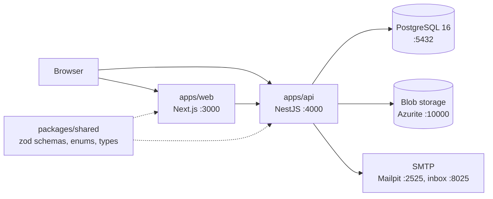
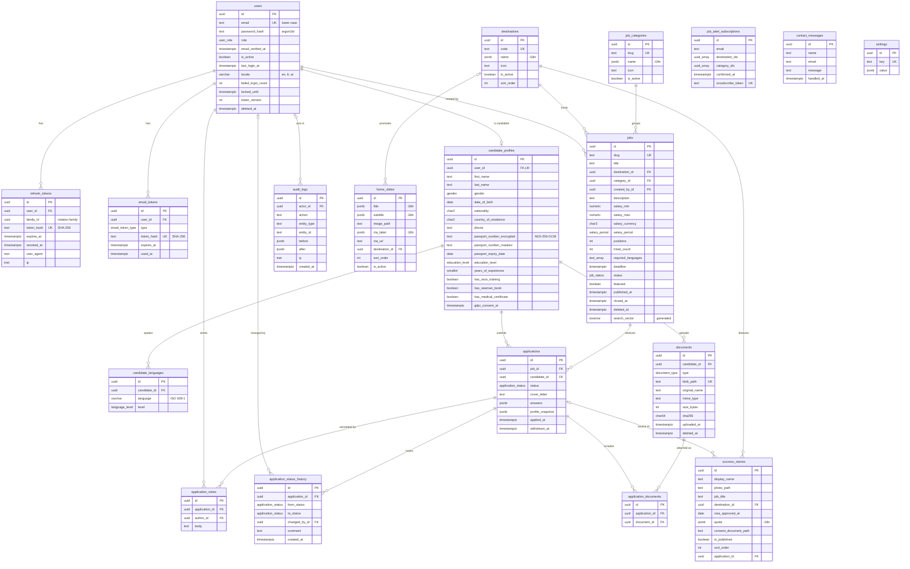
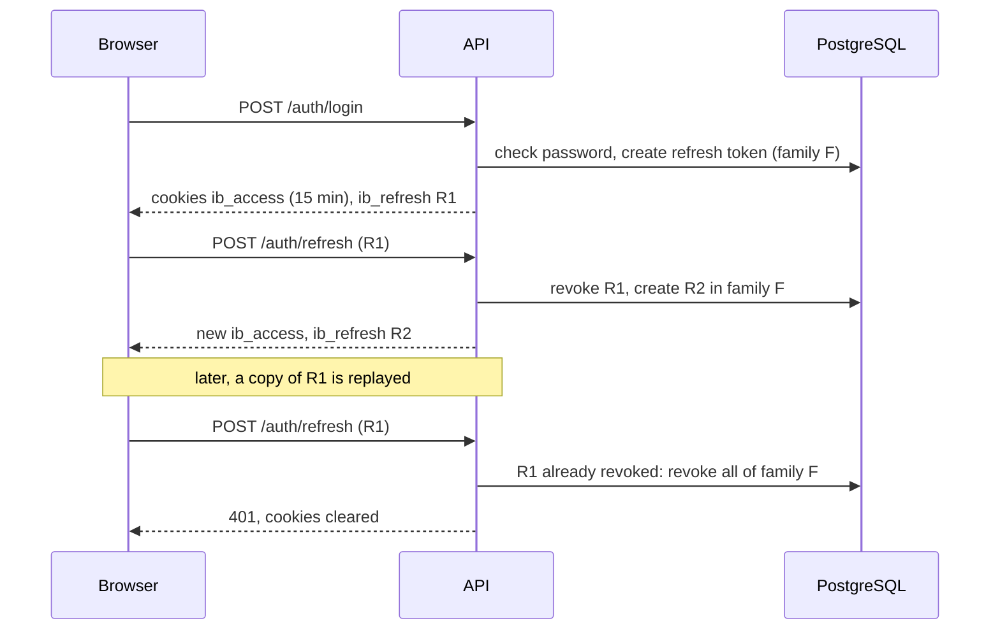
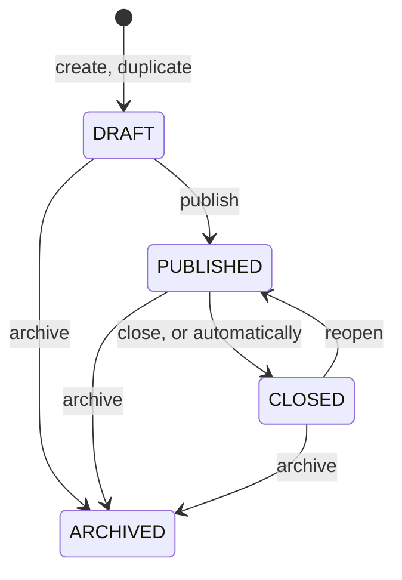

# Architecture

Current state of the repository. Feature scope is in [SPEC.md](SPEC.md); decisions are in [adr/](adr/).

## Overview

## Workspaces

| Path              | Package              | Role                                                        |
| ----------------- | -------------------- | ----------------------------------------------------------- |
| `apps/web`        | `@iconbridge/web`    | Next.js App Router, Tailwind CSS 4, shadcn/ui (RTL enabled) |
| `apps/api`        | `@iconbridge/api`    | NestJS 12 REST API (ESM), Prisma 7                          |
| `packages/shared` | `@iconbridge/shared` | zod schemas, enums and inferred types used by both apps     |
| `packages/config` | `@iconbridge/config` | ESLint, Prettier and tsconfig presets                       |
| `infra/terraform` | -                    | Azure infrastructure (empty for now)                        |

`packages/shared` is compiled to `dist/` (ESM + type declarations). Both apps import the compiled output, so it is built first; Turborepo handles the order.

## API

| URL                                                                     | Purpose                                                                                                 |
| ----------------------------------------------------------------------- | ------------------------------------------------------------------------------------------------------- |
| `/api/v1/*`                                                             | Business endpoints (global prefix)                                                                      |
| `/api/v1/jobs`, `/jobs/:slug`, `/destinations`, `/categories`, `/stats` | Public, no session                                                                                      |
| `/api/v1/auth/*`                                                        | Registration and sessions                                                                               |
| `/api/v1/admin/*`                                                       | Back office (never reachable by candidates)                                                             |
| `/api/docs`                                                             | Swagger UI; OpenAPI JSON at `/api/docs-json`                                                            |
| `/health/live`                                                          | Liveness: always 200 while the process runs                                                             |
| `/health/ready`                                                         | Readiness: 200 with `{"status":"ok","checks":{"database":"ok"}}`, 503 when the database does not answer |

The health endpoints are outside the `/api/v1` prefix so container probes keep a stable, unversioned path.

Structure of `apps/api/src`:

| File             | Role                                                                                         |
| ---------------- | -------------------------------------------------------------------------------------------- |
| `main.ts`        | Starts the server                                                                            |
| `app.setup.ts`   | Prefix, CORS, Swagger. Shared by `main.ts` and the e2e tests                                 |
| `config/env.ts`  | zod schema of the environment; the app refuses to start if a variable is missing             |
| `prisma/`        | `PrismaService` (global module), connects on first query                                     |
| `common/crypto/` | Passport field encryption, masking, password hashing                                         |
| `common/`        | `AppException`, exception filter, zod validation pipe, OpenAPI helpers, logger configuration |
| `auth/`          | Auth endpoints, sessions, tokens, password policy, Turnstile, guards and decorators          |
| `admin/`         | Admin accounts, audit interceptor and audit log                                              |
| `mail/`          | Nodemailer transport, translated MJML templates                                              |
| `jobs/`          | Public job search, admin job management, cover images, automatic closing                     |
| `catalog/`       | Destinations, categories and home-page counters, public and admin                            |
| `storage/`       | Azure Blob Storage client (public media container)                                           |
| `health/`        | Probe endpoints                                                                              |
| `generated/`     | Prisma client, generated, git-ignored                                                        |

## Data model

PostgreSQL 16 through Prisma. The schema is `apps/api/prisma/schema.prisma`; migrations are in `apps/api/prisma/migrations`. Decisions are in [ADR-002](adr/ADR-002-data-model.md).

### Conventions

- UUID primary keys generated by PostgreSQL (`gen_random_uuid()`), snake_case tables and columns, `timestamptz` everywhere.
- `created_at` and `updated_at` on every table, except the two append-only tables (`application_status_history`, `audit_logs`), which only have `created_at`.
- Soft delete (`deleted_at`) on `users`, `jobs` and `documents`.
- Translated text (destination and category names, slide texts, story quotes) is a JSON column shaped `{ "en", "fr", "ar" }` (`localizedTextSchema` in `packages/shared`). Job title and description are plain text.
- Enum values are identical to those of `packages/shared`; `apps/api/src/prisma/enums.spec.ts` fails if they diverge.
- Destinations are rows, not an enum, so admins can add countries.
- The seed (`pnpm db:seed`) creates missing rows and never overwrites existing ones.

### ER diagram

Main columns only; see the Prisma schema for the full list.

`job_alert_subscriptions`, `contact_messages` and `settings` have no foreign key. A job alert stores destination and category ids in arrays (empty means any).

### Rules enforced by the database

These are written by hand in the migration SQL, because Prisma cannot express them. Prisma leaves them in place and does not report them as drift.

| Table                              | Rule                                                                                                                                  |
| ---------------------------------- | ------------------------------------------------------------------------------------------------------------------------------------- |
| `jobs`                             | `positions >= 1`; `0 <= hired_count <= positions`; `salary_min <= salary_max`, both non-negative; contract duration at least 1 month  |
| `jobs`                             | `search_vector` is a generated column: title (weight A) and description (weight B), `simple` text-search configuration, GIN index     |
| `candidate_profiles`               | Encrypted and masked passport number are set or cleared together; issue date before expiry date; years of experience between 0 and 70 |
| `success_stories`                  | `is_published` requires `consent_document_path`                                                                                       |
| `users`, `job_alert_subscriptions` | `email` is lower case                                                                                                                 |
| `users`                            | `locale` is `en`, `fr` or `ar`; `failed_login_count >= 0`                                                                             |
| `documents`                        | `size_bytes > 0`                                                                                                                      |

Rules that need the current date or a setting (18 years or older, passport expiry, re-application cooldown, automatic closing of jobs) belong to the API and arrive with the features.

Indexes worth knowing:

| Index                                                  | Serves                                                             |
| ------------------------------------------------------ | ------------------------------------------------------------------ |
| `jobs (status, destination_id, category_id, deadline)` | Public job list and its filters                                    |
| `jobs` GIN on `search_vector`                          | Full-text search                                                   |
| `jobs` GIN on `required_languages`                     | Language filter                                                    |
| `jobs` GIN trigram on `title` (pg_trgm)                | Tolerant search on titles                                          |
| `applications (candidate_id, job_id, applied_at DESC)` | Last application of a candidate to a job (re-application cooldown) |

The `simple` configuration does no stemming: "welders" does not match "welder". It was chosen because offers may be written in English, French or Arabic and a generated column takes one fixed configuration.

### Deleting data

| When this is deleted                                    | What happens                                                                                                                                                                                                                       |
| ------------------------------------------------------- | ---------------------------------------------------------------------------------------------------------------------------------------------------------------------------------------------------------------------------------- |
| A user                                                  | Tokens and the candidate profile are deleted with it; the profile takes its languages, documents and applications (with their history, notes and attachments). `changed_by_id` and `actor_id` that pointed to the user become null |
| A job, destination or category that is still referenced | Refused. Jobs are soft-deleted instead                                                                                                                                                                                             |
| A user who created jobs or wrote notes                  | Refused: admin accounts are disabled (`is_active`), not deleted                                                                                                                                                                    |

## Sensitive data

### Passport number

The passport number is encrypted by the API before it reaches the database, so a database dump, a backup or a read-only SQL access does not reveal it.

| Column                      | Content                                                                                          | Use                                                                                         |
| --------------------------- | ------------------------------------------------------------------------------------------------ | ------------------------------------------------------------------------------------------- |
| `passport_number_encrypted` | `v1.<iv>.<tag>.<ciphertext>` (base64url)                                                         | Decrypted only when a recruiter opens one candidate, or for the candidate's own data export |
| `passport_number_masked`    | Last 3 characters, the rest replaced by `*` (`******567`); fully masked if 6 characters or fewer | Lists, search results, application snapshots, exports                                       |

- Algorithm: AES-256-GCM, with a new random 96-bit IV for every value and a 128-bit authentication tag. Code: `apps/api/src/common/crypto/field-cipher.ts` and `passport.ts`.
- The column name (`candidate_profiles.passport_number`) is authenticated as additional data: a payload copied into another column does not decrypt.
- The number is normalised (spaces removed, upper case) before encryption.
- Key: `PASSPORT_ENCRYPTION_KEY`, 32 random bytes in base64, validated at startup. Locally `pnpm env:init` generates it in `apps/api/.env`. In Azure it will be a Key Vault secret read through the managed identity.
- The `v1` prefix allows a later key or algorithm change: new values get a new prefix, old ones are re-encrypted by a script.
- Losing the key makes the stored numbers unreadable; candidates would have to enter them again. Back the key up with the same care as the database.
- Not possible by design: searching or sorting by passport number in SQL. If duplicate detection is needed later, add a keyed hash (HMAC) column.
- The clear number must never appear in logs, audit entries (`audit_logs.before` / `after`), application snapshots or error messages.

### Other secrets and personal data

| Data                         | Protection                                                                                  |
| ---------------------------- | ------------------------------------------------------------------------------------------- |
| Passwords                    | argon2id hash (`apps/api/src/common/crypto/password.ts`)                                    |
| Refresh tokens, email tokens | Only a SHA-256 hash is stored; the token itself exists only in the cookie or the email link |
| Candidate files              | Private blob container; the database stores the path, size, MIME type and SHA-256           |
| Internal notes               | Separate table, never returned by candidate endpoints                                       |
| Success stories              | Cannot be published without a consent document (database constraint)                        |

### Seed accounts

`pnpm db:seed` creates the super admin from `SEED_ADMIN_EMAIL` and `SEED_ADMIN_PASSWORD`. If a user with that email exists it is left unchanged. In development it also creates 12 sample jobs, 3 home slides, 4 success stories and 5 candidates (`candidate1@example.test` to `candidate5@example.test`, same password as the seed admin). All of it is invented: faker names, `example.test` emails, `+999` phone numbers, passport numbers starting with `FAKE`, and image paths that point to no file.

## Authentication and authorization

Decisions are in [ADR-003](adr/ADR-003-authentication.md). Code: `apps/api/src/auth`, `apps/api/src/admin`, `apps/api/src/mail`.

### Sessions

| Item          | Value                                                                                                                                    |
| ------------- | ---------------------------------------------------------------------------------------------------------------------------------------- |
| Access token  | JWT (HS256, `JWT_ACCESS_SECRET`), 15 minutes, cookie `ib_access`, path `/`                                                               |
| Refresh token | 256 random bits, 7 days, cookie `ib_refresh`, path `/api/v1/auth`; only its SHA-256 is stored                                            |
| Cookie flags  | `HttpOnly`, `Secure`, `SameSite=Lax` (browsers accept `Secure` on `http://localhost`)                                                    |
| Rotation      | Every refresh replaces the refresh token. A token presented a second time revokes the whole family (all tokens descended from one login) |
| Email links   | Verification 24 h, password reset 1 h, admin invitation 72 h. One use; a new link cancels the previous one; only the hash is stored      |
| Passwords     | argon2id; at least 10 characters and zxcvbn score 3 or more                                                                              |
| Lockout       | 5 wrong passwords lock the account for 15 minutes                                                                                        |
| CAPTCHA       | Cloudflare Turnstile on registration, checked server-side; refused if Cloudflare cannot be reached                                       |

The user row is read on every authenticated request. A disabled account, a role change, a password reset or a forced logout therefore takes effect on the next request, not when the access token expires. The token also carries `users.token_version`, which a password reset, a disable and a forced logout increment, so tokens issued before are rejected.

### No account enumeration

| Endpoint                                                       | Behaviour                                                                                                                                                                                 |
| -------------------------------------------------------------- | ----------------------------------------------------------------------------------------------------------------------------------------------------------------------------------------- |
| `POST /auth/register`                                          | Same `201` body whether or not the address has an account. An existing owner receives an "you already have an account" email                                                              |
| `POST /auth/login`                                             | One error (`401 INVALID_CREDENTIALS`) for unknown email, wrong password, disabled, invited-without-password and locked accounts. A dummy hash is verified when the account does not exist |
| `POST /auth/forgot-password`, `POST /auth/resend-verification` | Always `202` with the same body                                                                                                                                                           |

### Access rules

Four guards run globally, in this order:

| Guard                | Rule                                                                                                                                         |
| -------------------- | -------------------------------------------------------------------------------------------------------------------------------------------- |
| `ThrottlerGuard`     | Per IP and per minute: 120 by default, 20 on `/auth/*`, 5 on login, registration and the endpoints that send email. Health probes are exempt |
| `JwtAuthGuard`       | A valid access token is required unless the route is `@Public()`                                                                             |
| `RolesGuard`         | `@Roles(...)` lists come from `PERMISSIONS` in `packages/shared`, which mirrors the privileges table of SPEC.md                              |
| `VerifiedEmailGuard` | Routes marked `@RequireVerifiedEmail()` (applying to a job) refuse an unverified address                                                     |

`RolesGuard` also applies three rules that do not depend on a decorator being remembered:

1. A candidate never reaches a route under `/api/v1/admin`.
2. A route under `/api/v1/admin` without `@Roles()` is refused to everybody.
3. `VIEWER` never performs a write (anything but GET, HEAD, OPTIONS), unless the route is `@SelfService()`.

`OwnershipGuard` with `@Owned('candidateProfile' | 'document' | 'application', param)` restricts a candidate to their own records. Somebody else's record answers 404, like a missing one.

### Admin accounts and audit log

- `/api/v1/admin/users` (super admin): list, create, change role, disable, enable, force logout. A new account has no password; the invitation email carries a set-password link handled by `POST /auth/reset-password`.
- The last active super admin cannot be demoted or disabled, and nobody can disable their own account. The check locks the super-admin rows, so two concurrent requests cannot both pass.
- `AuditInterceptor` records every successful write by a back-office user in `audit_logs`: actor, action, record, state before and after, IP. `@Audit({ action, entityType, idParam })` names the entry; without it the write is still recorded under `<METHOD> <route>`. Snapshots come from `AuditSnapshotService`, which selects non-secret fields only. `GET /api/v1/admin/audit-logs` lists the entries.

### Errors, logs, HTTP hardening

- Every error is `{ code, message, details? }`; codes are `API_ERROR_CODES` in `packages/shared`. Unexpected errors answer `INTERNAL_ERROR` with a generic message; the stack is logged, and returned only in development.
- Request bodies, query strings and route parameters are validated with zod schemas from `packages/shared` (`ZodBody`, `ZodQuery`, `ZodParams`). The same schemas generate the OpenAPI request bodies.
- Logs are JSON (pino), one line per request with a request id, also returned in the `x-request-id` header. Passwords, tokens, passport numbers, cookies and the `Authorization` header are redacted; query strings are not logged.
- `helmet` sets the security headers; CORS allows only `WEB_ORIGIN`, with credentials.

### Email

`MailService` sends through Nodemailer (SMTP, STARTTLS required in production). Four templates (verify email, reset password, invitation, account exists) exist in English, French and Arabic; one MJML layout renders them, right-to-left for Arabic. The language is `users.locale`. Links open `WEB_ORIGIN/<locale>/verify-email`, `/reset-password`, `/set-password` and `/forgot-password`. A delivery failure is logged and does not fail the request.

## Job offers

Decisions are in [ADR-004](adr/ADR-004-job-search-and-media.md). Code: `apps/api/src/jobs`, `apps/api/src/catalog`, `apps/api/src/storage`.

### When a job is public

A job is open to candidates when all four conditions hold:

1. its status is `PUBLISHED`;
2. it is not soft-deleted;
3. its deadline is in the future;
4. `hired_count < positions`.

The rule exists once in SQL (`OPEN_JOB_SQL` in `public-jobs.service.ts`) and once in TypeScript (`isJobOpen` in `packages/shared`). Every public query uses it, so an expired or full job disappears immediately, without waiting for the scheduled task. A job that is not open answers 404 on `GET /jobs/:slug`, exactly like an unknown slug.

### Status changes

- The table is `JOB_TRANSITIONS` in `packages/shared`; another move answers `409 INVALID_JOB_TRANSITION`.
- Publish and reopen need a future deadline, a free position, and an active destination and category (`409 JOB_NOT_PUBLISHABLE`).
- A new job is always a draft. Status, slug, hired count and the featured mark cannot be set through create or update.
- Delete is a soft delete. `DELETE /admin/jobs/:id?permanent=true` removes the row and is refused with `409 JOB_HAS_APPLICATIONS` when applications exist.
- Slug: title plus the English name of the destination (`hotel-receptionist-malta`), then `-2`, `-3`. It follows the title only while the job has never been published. Deleted jobs keep their slug.

### Search (`GET /api/v1/jobs?q=`)

A job matches when either part matches:

| Part        | How                                                                                                                                            | Finds                                                      |
| ----------- | ---------------------------------------------------------------------------------------------------------------------------------------------- | ---------------------------------------------------------- |
| Full text   | Every word of the query, as a prefix, in `search_vector` (title weight A, description weight B). Only letters and digits of the query are kept | "recep" finds Receptionist; "hotel guest" needs both words |
| Fuzzy title | `q <% title` (pg_trgm word similarity, threshold 0.6), served by the GIN trigram index `jobs_title_trgm_idx`                                   | "welders" finds Welder; "reciptionist" finds Receptionist  |

Results are ordered by `ts_rank` plus title similarity when `q` is given, otherwise by publication date. Other sorts: `deadline`, `salary`. Salary filters compare amounts as stored, so they are meaningful together with `currency`. Typos are tolerated on the title only, not in the description.

### Automatic closing

`JobAvailabilityService` runs every 15 minutes (`@nestjs/schedule`). In one transaction it takes a PostgreSQL advisory lock with `pg_try_advisory_xact_lock`, closes the published jobs whose deadline has passed or whose positions are filled, and writes one `job.auto_close` audit entry per job (no actor). With several API replicas, the ones that do not get the lock skip their turn. Each closed job is logged with its slug and the reason.

### Cover images and public media

- `POST /admin/jobs/:id/cover` accepts one file of 5 MB at most. The real format is read from the bytes with sharp: JPEG, PNG or WebP, otherwise `415 UNSUPPORTED_FILE`.
- The image is rotated according to EXIF, limited to 1200 px wide, and re-encoded as WebP, which also removes EXIF data.
- It is stored in the blob container `public-media` at `jobs/<job id>/cover-<content hash>.webp`, with a one-year cache header. The API returns `PUBLIC_MEDIA_BASE_URL` + path as `coverImageUrl`.
- `public-media` allows anonymous read of single blobs (no listing). It is for public images only. Candidate documents will use a different, private container.

### Destinations, categories, counters

- Public: `GET /destinations` and `GET /categories` return the active ones with their number of open jobs. `GET /stats` returns open jobs, registered candidates, visas approved (applications in `VISA_APPROVED` or `DEPLOYED`) and countries; it is cached for 10 minutes in each API instance and sent with `Cache-Control: public, max-age=600`.
- Back office: `/admin/destinations` and `/admin/categories`. Deleting one that jobs (or stories, slides) still use deactivates it instead. The destination code and the category slug cannot be changed. Deactivating does not hide existing jobs; it removes the entry from the public lists and from the choices for new jobs.

### Who can do what

| Routes                                                        | Viewer | Recruiter | Super admin |
| ------------------------------------------------------------- | ------ | --------- | ----------- |
| `GET /admin/jobs`, `/admin/destinations`, `/admin/categories` | Yes    | Yes       | Yes         |
| Every write on those routes                                   | No     | Yes       | Yes         |

## Configuration

| File            | Read by              | Validation                                        |
| --------------- | -------------------- | ------------------------------------------------- |
| `.env` (root)   | `docker-compose.yml` | Optional: every variable has a default            |
| `apps/api/.env` | API, Prisma CLI      | `apps/api/src/config/env.ts`, at startup          |
| `apps/web/.env` | Next.js              | `apps/web/src/lib/env.ts`, at dev start and build |

Each has a documented `.env.example`. `pnpm env:init` copies the examples to `.env` files that do not exist yet.

## Local services

| Service  | Image                                     | Host port                      | Notes                                                                                                                 |
| -------- | ----------------------------------------- | ------------------------------ | --------------------------------------------------------------------------------------------------------------------- |
| postgres | `postgres:16-alpine`                      | 5432                           | Volume `postgres-data`                                                                                                |
| azurite  | `mcr.microsoft.com/azure-storage/azurite` | 10000                          | Blob only, volume `azurite-data`; started with `--skipApiVersionCheck` because the Azure SDK is ahead of the emulator |
| mailpit  | `axllent/mailpit`                         | 2525 (SMTP), 8025 (UI and API) | Host port 1025 is reserved by Windows on the dev workstation                                                          |
| pgadmin  | `dpage/pgadmin4`                          | 5050                           | Only with `docker compose --profile tools up -d`                                                                      |

All ports are bound to 127.0.0.1 and every service has a health check; `pnpm dev` waits for them.

## Testing

| Workspace                        | Runner             | Scope today                                                                                                                                                                                                                                                                                                                                                                                                          |
| -------------------------------- | ------------------ | -------------------------------------------------------------------------------------------------------------------------------------------------------------------------------------------------------------------------------------------------------------------------------------------------------------------------------------------------------------------------------------------------------------------- |
| `packages/shared`                | Vitest             | Enums and schemas                                                                                                                                                                                                                                                                                                                                                                                                    |
| `apps/api` unit (`pnpm test`)    | Vitest             | No database: auth service, guards, exception filter, validation pipe, password policy, Turnstile, mail templates, log redaction, crypto helpers, environment validation, Prisma enums equal to the shared ones                                                                                                                                                                                                       |
| `apps/api` e2e (`pnpm test:e2e`) | Vitest + supertest | The real application over HTTP against a PostgreSQL test database: full auth flow, token rotation and reuse, lockout, password reset, role matrix on every admin route, ownership, admin accounts, audit log, rate limits, job search and filters, visibility rules, job management and permissions per role, automatic closing with concurrent runs. Mail, CAPTCHA and blob storage are replaced by in-memory fakes |
| `apps/web`                       | Vitest             | Environment validation                                                                                                                                                                                                                                                                                                                                                                                               |

The e2e suites create the database `<name>_test` next to the development one (or use `TEST_DATABASE_URL`), apply the migrations, and empty the tables between tests. They refuse to run on a database whose name does not end in `_test`. Routes that do not exist yet (candidates, jobs, applications) are represented by test-only controllers in `apps/api/test/e2e/fixtures.controller.ts`, so the guards are exercised with the decorators real controllers will use.

## Not built yet

Candidate profile and documents, applications, private file upload, the web pages behind the email links, i18n of the web app, Dockerfiles, Terraform and CI/CD.
