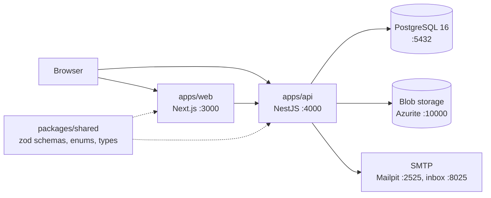
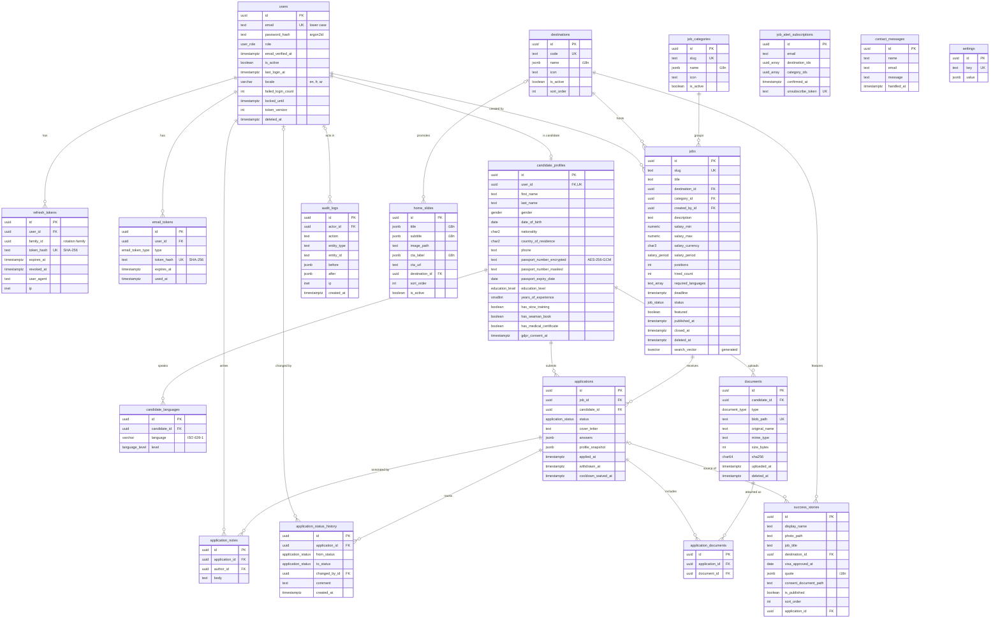
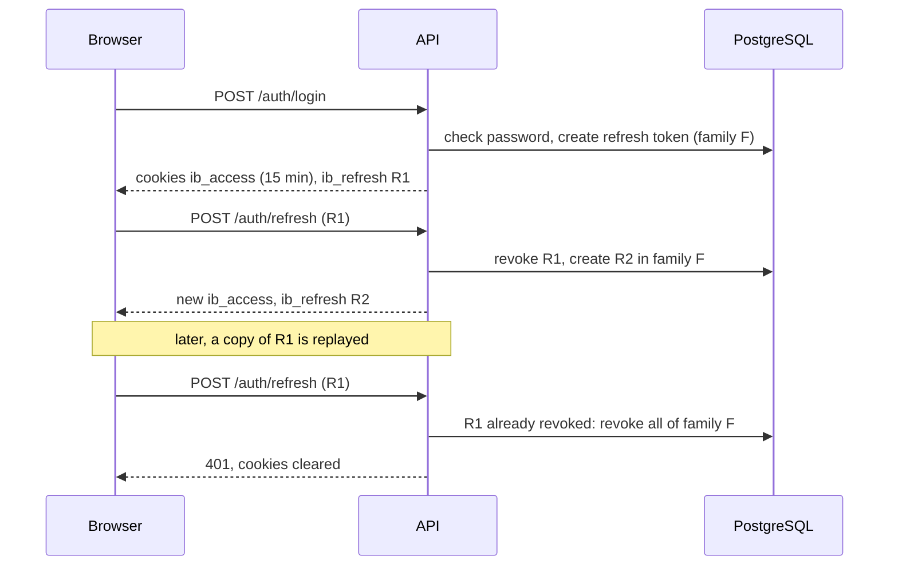
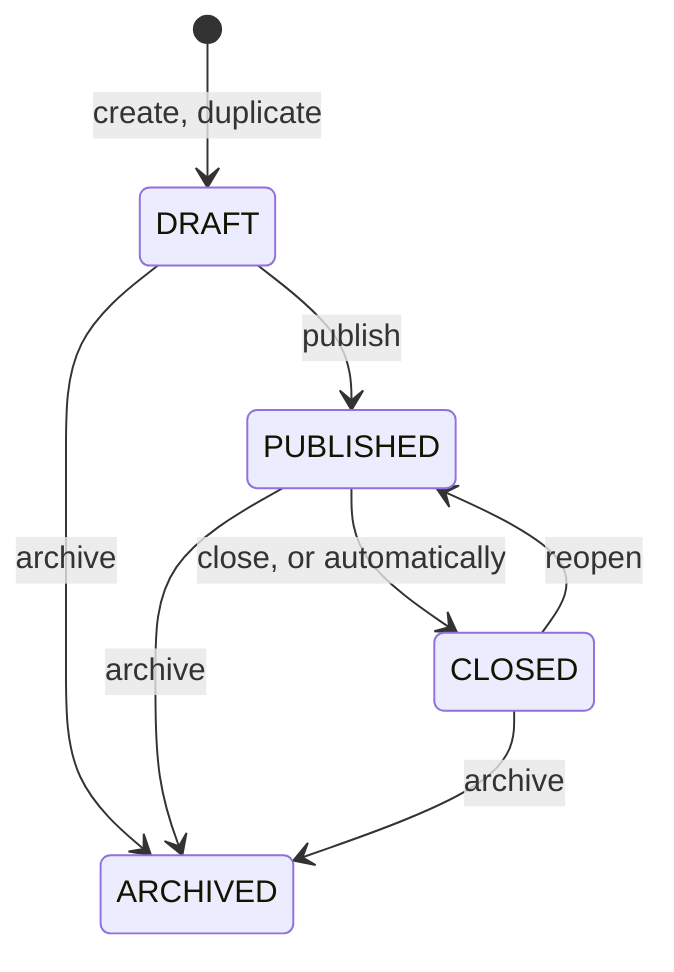
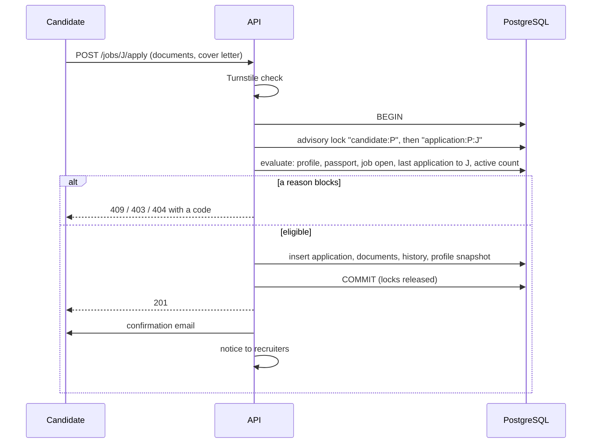
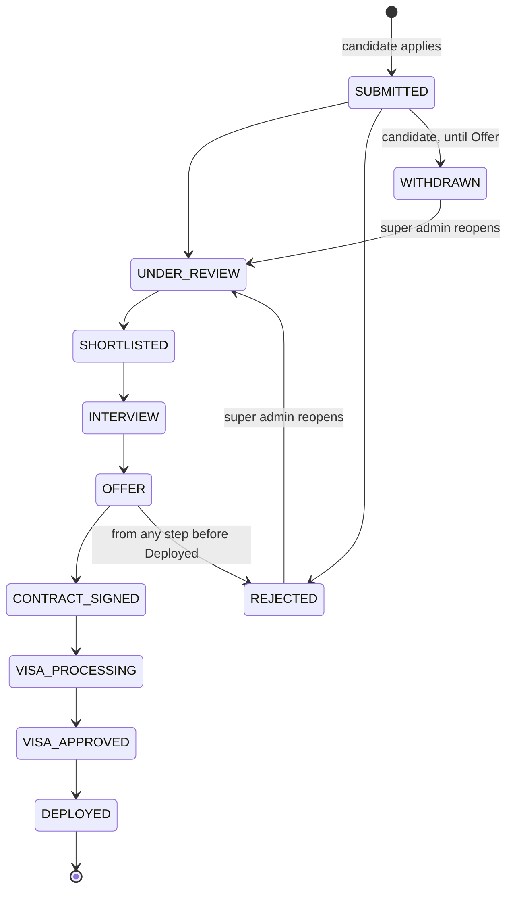
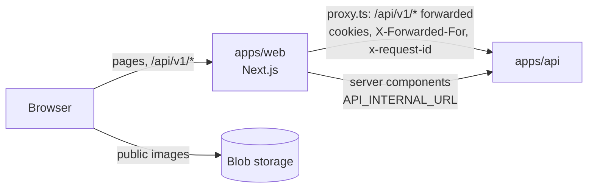
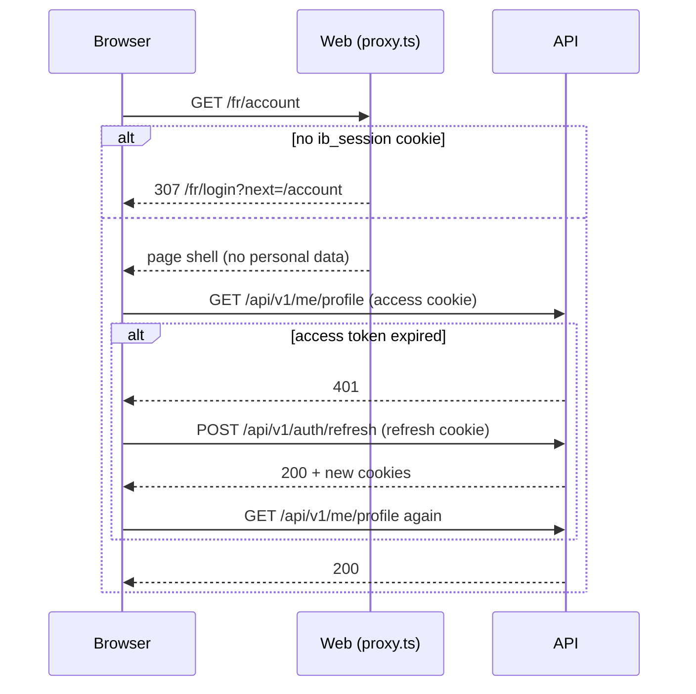
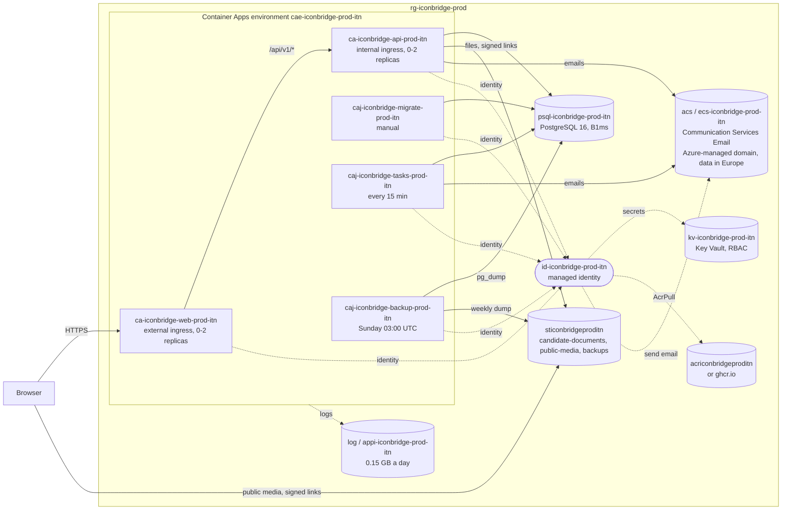

# Architecture

Current state of the repository. Feature scope is in [SPEC.md](SPEC.md); decisions are in [adr/](adr/).

## Overview

## Workspaces

| Path              | Package              | Role                                                        |
| ----------------- | -------------------- | ----------------------------------------------------------- |
| `apps/web`        | `@iconbridge/web`    | Next.js App Router, Tailwind CSS 4, shadcn/ui (RTL enabled) |
| `apps/api`        | `@iconbridge/api`    | NestJS 12 REST API (ESM), Prisma 7                          |
| `packages/shared` | `@iconbridge/shared` | zod schemas, enums and inferred types used by both apps     |
| `packages/config` | `@iconbridge/config` | ESLint, Prettier and tsconfig presets                       |
| `infra/terraform` | -                    | Azure infrastructure (empty for now)                        |

`packages/shared` is compiled to `dist/` (ESM + type declarations). Both apps import the compiled output, so it is built first; Turborepo handles the order.

## API

| URL                                                                                   | Purpose                                                                                                 |
| ------------------------------------------------------------------------------------- | ------------------------------------------------------------------------------------------------------- |
| `/api/v1/*`                                                                           | Business endpoints (global prefix)                                                                      |
| `/api/v1/jobs`, `/jobs/:slug`, `/destinations`, `/categories`, `/stats`               | Public, no session                                                                                      |
| `/api/v1/auth/*`                                                                      | Registration and sessions                                                                               |
| `/api/v1/me/*`, `/jobs/:id/apply`, `/jobs/:id/eligibility`, `/documents/:id/download` | Candidate side (download also for the back office)                                                      |
| `/api/v1/admin/*`                                                                     | Back office (never reachable by candidates)                                                             |
| `/api/docs`                                                                           | Swagger UI; OpenAPI JSON at `/api/docs-json`                                                            |
| `/health/live`                                                                        | Liveness: always 200 while the process runs                                                             |
| `/health/ready`                                                                       | Readiness: 200 with `{"status":"ok","checks":{"database":"ok"}}`, 503 when the database does not answer |

The health endpoints are outside the `/api/v1` prefix so container probes keep a stable, unversioned path.

Structure of `apps/api/src`:

| File                                                     | Role                                                                                                     |
| -------------------------------------------------------- | -------------------------------------------------------------------------------------------------------- |
| `main.ts`                                                | Starts the server                                                                                        |
| `app.setup.ts`                                           | Prefix, CORS, Swagger. Shared by `main.ts` and the e2e tests                                             |
| `config/env.ts`                                          | zod schema of the environment; the app refuses to start if a variable is missing                         |
| `prisma/`                                                | `PrismaService` (global module), connects on first query                                                 |
| `common/crypto/`                                         | Passport field encryption, masking, password hashing                                                     |
| `common/`                                                | `AppException`, exception filter, zod validation pipe, OpenAPI helpers, logger configuration             |
| `auth/`                                                  | Auth endpoints, sessions, tokens, password policy, Turnstile, guards and decorators                      |
| `admin/`                                                 | Admin accounts, audit interceptor and audit log                                                          |
| `mail/`                                                  | Outbox, translated MJML templates, transports: Nodemailer (SMTP) and Azure Communication Services        |
| `jobs/`                                                  | Public job search, admin job management, cover images, automatic closing                                 |
| `catalog/`                                               | Destinations, categories and home-page counters, public and admin                                        |
| `storage/`                                               | `StorageService` interface and its Azure Blob implementation (public media, private candidate documents) |
| `candidates/`, `documents/`, `applications/`, `account/` | Candidate profile, documents, applications and GDPR rights                                               |
| `settings/`                                              | Reads the `settings` table with defaults                                                                 |
| `admin/applications/`, `admin/candidates/`               | Back-office management of applications (state machine, notes, exports) and candidates                    |
| `content/`, `public-forms/`                              | Success stories, home slides, site info; job alerts and the contact form                                 |
| `tasks/`, `cli.ts`                                       | Scheduled tasks, their lock, and the command line that runs them                                         |
| `health/`                                                | Probe endpoints                                                                                          |
| `generated/`                                             | Prisma client, generated, git-ignored                                                                    |

## Data model

PostgreSQL 16 through Prisma. The schema is `apps/api/prisma/schema.prisma`; migrations are in `apps/api/prisma/migrations`. Decisions are in [ADR-002](adr/ADR-002-data-model.md).

### Conventions

- UUID primary keys generated by PostgreSQL (`gen_random_uuid()`), snake_case tables and columns, `timestamptz` everywhere.
- `created_at` and `updated_at` on every table, except the two append-only tables (`application_status_history`, `audit_logs`), which only have `created_at`.
- Soft delete (`deleted_at`) on `users`, `jobs` and `documents`.
- Translated text (destination and category names, slide texts, story quotes) is a JSON column shaped `{ "en", "fr", "ar" }` (`localizedTextSchema` in `packages/shared`). Job title and description are plain text.
- Enum values are identical to those of `packages/shared`; `apps/api/src/prisma/enums.spec.ts` fails if they diverge.
- Destinations are rows, not an enum, so admins can add countries.
- The seed (`pnpm db:seed`) creates missing rows and never overwrites existing ones.

### ER diagram

Main columns only; see the Prisma schema for the full list.

`job_alert_subscriptions`, `contact_messages` and `settings` have no foreign key. `email_outbox` (not drawn) holds the emails to send: template, language, encrypted content, status (`PENDING`, `SENT`, `FAILED`, `CANCELLED`), attempts and the time of the next one; `application_status_history.email_id` points to the email that announced a status change. `users.retention_warned_at` (not drawn) is the date of the warning sent before an inactive account is erased. A job alert stores destination and category ids in arrays (empty means any).

### Rules enforced by the database

These are written by hand in the migration SQL, because Prisma cannot express them. Prisma leaves them in place and does not report them as drift.

| Table                              | Rule                                                                                                                                  |
| ---------------------------------- | ------------------------------------------------------------------------------------------------------------------------------------- |
| `jobs`                             | `positions >= 1`; `0 <= hired_count <= positions`; `salary_min <= salary_max`, both non-negative; contract duration at least 1 month  |
| `jobs`                             | `search_vector` is a generated column: title (weight A) and description (weight B), `simple` text-search configuration, GIN index     |
| `candidate_profiles`               | Encrypted and masked passport number are set or cleared together; issue date before expiry date; years of experience between 0 and 70 |
| `success_stories`                  | `is_published` requires `consent_document_path`                                                                                       |
| `users`, `job_alert_subscriptions` | `email` is lower case                                                                                                                 |
| `users`                            | `locale` is `en`, `fr` or `ar`; `failed_login_count >= 0`                                                                             |
| `documents`                        | `size_bytes > 0`                                                                                                                      |
| `email_outbox`                     | `priority` between 1 and 3                                                                                                            |

Rules that need the current date or a setting (18 years or older, passport expiry, re-application cooldown, automatic closing of jobs) belong to the API and arrive with the features.

Indexes worth knowing:

| Index                                                  | Serves                                                             |
| ------------------------------------------------------ | ------------------------------------------------------------------ |
| `jobs (status, destination_id, category_id, deadline)` | Public job list and its filters                                    |
| `jobs` GIN on `search_vector`                          | Full-text search                                                   |
| `jobs` GIN on `required_languages`                     | Language filter                                                    |
| `jobs` GIN trigram on `title` (pg_trgm)                | Tolerant search on titles                                          |
| `applications (candidate_id, job_id, applied_at DESC)` | Last application of a candidate to a job (re-application cooldown) |
| `applications (applied_at DESC)`                       | Back-office list of applications, newest first                     |
| `users (role, deleted_at)`                             | Back-office lists of candidates and of staff accounts              |
| `email_outbox (status, next_attempt_at)`               | Emails due for delivery                                            |
| `email_outbox (status, priority, next_attempt_at)`     | Emails due, most urgent first                                      |
| `email_outbox (template, sent_at)`                     | Job alerts sent in the last hour (half-quota cap)                  |

The `simple` configuration does no stemming: "welders" does not match "welder". It was chosen because offers may be written in English, French or Arabic and a generated column takes one fixed configuration.

### Deleting data

| When this is deleted                                    | What happens                                                                                                                                                                                                                       |
| ------------------------------------------------------- | ---------------------------------------------------------------------------------------------------------------------------------------------------------------------------------------------------------------------------------- |
| A user                                                  | Tokens and the candidate profile are deleted with it; the profile takes its languages, documents and applications (with their history, notes and attachments). `changed_by_id` and `actor_id` that pointed to the user become null |
| A job, destination or category that is still referenced | Refused. Jobs are soft-deleted instead                                                                                                                                                                                             |
| A user who created jobs or wrote notes                  | Refused: admin accounts are disabled (`is_active`), not deleted                                                                                                                                                                    |

## Sensitive data

### Passport number

The passport number is encrypted by the API before it reaches the database, so a database dump, a backup or a read-only SQL access does not reveal it.

| Column                      | Content                                                                                          | Use                                                                                         |
| --------------------------- | ------------------------------------------------------------------------------------------------ | ------------------------------------------------------------------------------------------- |
| `passport_number_encrypted` | `v1.<iv>.<tag>.<ciphertext>` (base64url)                                                         | Decrypted only when a recruiter opens one candidate, or for the candidate's own data export |
| `passport_number_masked`    | Last 3 characters, the rest replaced by `*` (`******567`); fully masked if 6 characters or fewer | Lists, search results, application snapshots, exports                                       |

- Algorithm: AES-256-GCM, with a new random 96-bit IV for every value and a 128-bit authentication tag. Code: `apps/api/src/common/crypto/field-cipher.ts` and `passport.ts`.
- The column name (`candidate_profiles.passport_number`) is authenticated as additional data: a payload copied into another column does not decrypt.
- The number is normalised (spaces removed, upper case) before encryption.
- Key: `PASSPORT_ENCRYPTION_KEY`, 32 random bytes in base64, validated at startup. Locally `pnpm env:init` generates it in `apps/api/.env`. In Azure it will be a Key Vault secret read through the managed identity.
- The `v1` prefix allows a later key or algorithm change: new values get a new prefix, old ones are re-encrypted by a script.
- Losing the key makes the stored numbers unreadable; candidates would have to enter them again. Back the key up with the same care as the database.
- Not possible by design: searching or sorting by passport number in SQL. If duplicate detection is needed later, add a keyed hash (HMAC) column.
- The clear number must never appear in logs, audit entries (`audit_logs.before` / `after`), application snapshots or error messages.

### Other secrets and personal data

| Data                         | Protection                                                                                  |
| ---------------------------- | ------------------------------------------------------------------------------------------- |
| Passwords                    | argon2id hash (`apps/api/src/common/crypto/password.ts`)                                    |
| Refresh tokens, email tokens | Only a SHA-256 hash is stored; the token itself exists only in the cookie or the email link |
| Candidate files              | Private blob container; the database stores the path, size, MIME type and SHA-256           |
| Internal notes               | Separate table, never returned by candidate endpoints                                       |
| Success stories              | Cannot be published without a consent document (database constraint)                        |

### Seed accounts

`pnpm db:seed` creates the super admin from `SEED_ADMIN_EMAIL` and `SEED_ADMIN_PASSWORD`. If a user with that email exists it is left unchanged. In development it also creates 12 sample jobs, 3 home slides, 4 success stories and 5 candidates (`candidate1@example.test` to `candidate5@example.test`, same password as the seed admin). All of it is invented: faker names, `example.test` emails, `+999` phone numbers, passport numbers starting with `FAKE`, and image paths that point to no file.

## Authentication and authorization

Decisions are in [ADR-003](adr/ADR-003-authentication.md). Code: `apps/api/src/auth`, `apps/api/src/admin`, `apps/api/src/mail`.

### Sessions

| Item          | Value                                                                                                                                    |
| ------------- | ---------------------------------------------------------------------------------------------------------------------------------------- |
| Access token  | JWT (HS256, `JWT_ACCESS_SECRET`), 15 minutes, cookie `ib_access`, path `/`                                                               |
| Refresh token | 256 random bits, 7 days, cookie `ib_refresh`, path `/api/v1/auth`; only its SHA-256 is stored                                            |
| Cookie flags  | `HttpOnly`, `Secure`, `SameSite=Lax` (browsers accept `Secure` on `http://localhost`)                                                    |
| Rotation      | Every refresh replaces the refresh token. A token presented a second time revokes the whole family (all tokens descended from one login) |
| Email links   | Verification 24 h, password reset 1 h, admin invitation 72 h. One use; a new link cancels the previous one; only the hash is stored      |
| Passwords     | argon2id; at least 10 characters and zxcvbn score 3 or more                                                                              |
| Lockout       | 5 wrong passwords lock the account for 15 minutes                                                                                        |
| CAPTCHA       | Cloudflare Turnstile on registration, checked server-side; refused if Cloudflare cannot be reached                                       |

The user row is read on every authenticated request. A disabled account, a role change, a password reset or a forced logout therefore takes effect on the next request, not when the access token expires. The token also carries `users.token_version`, which a password reset, a disable and a forced logout increment, so tokens issued before are rejected.

### No account enumeration

| Endpoint                                                       | Behaviour                                                                                                                                                                                 |
| -------------------------------------------------------------- | ----------------------------------------------------------------------------------------------------------------------------------------------------------------------------------------- |
| `POST /auth/register`                                          | Same `201` body whether or not the address has an account. An existing owner receives an "you already have an account" email                                                              |
| `POST /auth/login`                                             | One error (`401 INVALID_CREDENTIALS`) for unknown email, wrong password, disabled, invited-without-password and locked accounts. A dummy hash is verified when the account does not exist |
| `POST /auth/forgot-password`, `POST /auth/resend-verification` | Always `202` with the same body                                                                                                                                                           |

### Access rules

Four guards run globally, in this order:

| Guard                | Rule                                                                                                                                         |
| -------------------- | -------------------------------------------------------------------------------------------------------------------------------------------- |
| `ThrottlerGuard`     | Per IP and per minute: 120 by default, 20 on `/auth/*`, 5 on login, registration and the endpoints that send email. Health probes are exempt |
| `JwtAuthGuard`       | A valid access token is required unless the route is `@Public()`                                                                             |
| `RolesGuard`         | `@Roles(...)` lists come from `PERMISSIONS` in `packages/shared`, which mirrors the privileges table of SPEC.md                              |
| `VerifiedEmailGuard` | Routes marked `@RequireVerifiedEmail()` (applying to a job) refuse an unverified address                                                     |

`RolesGuard` also applies three rules that do not depend on a decorator being remembered:

1. A candidate never reaches a route under `/api/v1/admin`.
2. A route under `/api/v1/admin` without `@Roles()` is refused to everybody.
3. `VIEWER` never performs a write (anything but GET, HEAD, OPTIONS), unless the route is `@SelfService()`.

`OwnershipGuard` with `@Owned('candidateProfile' | 'document' | 'application', param)` restricts a candidate to their own records. Somebody else's record answers 404, like a missing one.

### Admin accounts and audit log

- `/api/v1/admin/users` (super admin): list, create, change role, disable, enable, force logout. A new account has no password; the invitation email carries a set-password link handled by `POST /auth/reset-password`.
- The last active super admin cannot be demoted or disabled, and nobody can disable their own account. The check locks the super-admin rows, so two concurrent requests cannot both pass.
- `AuditInterceptor` records every successful write by a back-office user in `audit_logs`: actor, action, record, state before and after, IP. `@Audit({ action, entityType, idParam })` names the entry; without it the write is still recorded under `<METHOD> <route>`. Snapshots come from `AuditSnapshotService`, which selects non-secret fields only. `GET /api/v1/admin/audit-logs` lists the entries.

### Errors, logs, HTTP hardening

- Every error is `{ code, message, details? }`; codes are `API_ERROR_CODES` in `packages/shared`. Unexpected errors answer `INTERNAL_ERROR` with a generic message; the stack is logged, and returned only in development.
- Request bodies, query strings and route parameters are validated with zod schemas from `packages/shared` (`ZodBody`, `ZodQuery`, `ZodParams`). The same schemas generate the OpenAPI request bodies.
- Logs are JSON (pino), one line per request with a request id, also returned in the `x-request-id` header. Passwords, tokens, passport numbers, cookies and the `Authorization` header are redacted; query strings are not logged.
- `helmet` sets the security headers; CORS allows only `WEB_ORIGIN`, with credentials.
- `originCheck` refuses a state-changing request whose `Origin` or `Referer` is another site (CSRF); requests with neither header go on to the normal checks.
- Rate limits are per client address (`RATE_LIMITS` in `auth/auth.constants.ts`). `RATE_LIMITS_ENABLED=false` turns them off for load and browser tests and is refused in production.
- The HTTP server keeps idle connections for 65 seconds, longer than its clients (the web app, the Azure ingress) do, so a request never meets a connection being closed.

The full list of protections, with the test behind each, is in [SECURITY.md](SECURITY.md).

### Email

`MailService` writes every email to an outbox and delivers it through a transport chosen by `EMAIL_TRANSPORT`: Nodemailer (`smtp`: Mailpit locally, STARTTLS required in production) or Azure Communication Services Email (`azure`: production, managed identity, no password; [ADR-014](adr/ADR-014-email-azure-communication-services.md)). Four templates (verify email, reset password, invitation, account exists) exist in English, French and Arabic; one MJML layout renders them, right-to-left for Arabic. The language is `users.locale`. Links open `WEB_ORIGIN/<locale>/verify-email`, `/reset-password`, `/set-password` and `/forgot-password`.

**Outbox.** `mail.send()` only inserts a row in `email_outbox` (template, language, and the address and variables encrypted with `FieldCipher`) and returns: a request never waits for SMTP, and a bulk change of 100 applications answers at once. Delivery happens afterwards:

| Step            | Rule                                                                                                                                                                                                                                                                                                                                                                                                              |
| --------------- | ----------------------------------------------------------------------------------------------------------------------------------------------------------------------------------------------------------------------------------------------------------------------------------------------------------------------------------------------------------------------------------------------------------------- |
| First attempt   | Right after the request, in the background of the same process (`MAIL_DELIVERY=background`), three emails at a time over pooled SMTP connections                                                                                                                                                                                                                                                                  |
| Scheduled task  | `send-emails`, every minute: sends what is due, whatever process wrote it                                                                                                                                                                                                                                                                                                                                         |
| Failure         | Tried again after 1, 2, 4… minutes, at most every 6 hours, 20 attempts (about three days), then marked `FAILED`                                                                                                                                                                                                                                                                                                   |
| Several runners | A row is claimed with a two-minute lease before it is sent, so two runners never send the same email; a runner that dies frees it                                                                                                                                                                                                                                                                                 |
| After sending   | The content is erased at once; the row is removed after 30 days                                                                                                                                                                                                                                                                                                                                                   |
| Shutdown        | The emails being sent are finished and the SMTP connections closed, so the task command exits and no email leaves twice                                                                                                                                                                                                                                                                                           |
| Priorities      | `EMAIL_PRIORITY` (`mail-priority.ts`), stored in `email_outbox.priority`: 1 account access (verification, password reset, invitation, account exists), 2 applications (received, status, correction) and other awaited emails (job alert confirmation, retention warning), 3 bulk (job alerts, recruiter notices, contact messages). A run fetches three due rows at a time, most urgent first, then oldest first |
| Job-alert cap   | With `EMAIL_HOURLY_QUOTA` set (10 in Azure), job alerts sent or being sent in the last 60 minutes never exceed half of it; counted and claimed under an advisory lock, so replicas and the task job share the cap. Other emails are not held back                                                                                                                                                                 |
| Over quota      | The transport throws `MailThrottledError` (Azure 429): the email waits as long as asked without spending an attempt, and the process sends nothing until then                                                                                                                                                                                                                                                     |

A status change keeps the id of its email: undoing the change cancels an email that has not left yet, or sends a correction if it has. `MAIL_DELIVERY=inline` (tests) sends during the request.

## Job offers

Decisions are in [ADR-004](adr/ADR-004-job-search-and-media.md). Code: `apps/api/src/jobs`, `apps/api/src/catalog`, `apps/api/src/storage`.

### When a job is public

A job is open to candidates when all four conditions hold:

1. its status is `PUBLISHED`;
2. it is not soft-deleted;
3. its deadline is in the future;
4. `hired_count < positions`.

The rule exists once in SQL (`OPEN_JOB_SQL` in `public-jobs.service.ts`) and once in TypeScript (`isJobOpen` in `packages/shared`). Every public query uses it, so an expired or full job disappears immediately, without waiting for the scheduled task. A job that is not open answers 404 on `GET /jobs/:slug`, exactly like an unknown slug.

### Status changes

- The table is `JOB_TRANSITIONS` in `packages/shared`; another move answers `409 INVALID_JOB_TRANSITION`.
- Publish and reopen need a future deadline, a free position, and an active destination and category (`409 JOB_NOT_PUBLISHABLE`).
- A new job is always a draft. Status, slug, hired count and the featured mark cannot be set through create or update.
- Delete is a soft delete. `DELETE /admin/jobs/:id?permanent=true` removes the row and is refused with `409 JOB_HAS_APPLICATIONS` when applications exist.
- Slug: title plus the English name of the destination (`hotel-receptionist-malta`), then `-2`, `-3`. It follows the title only while the job has never been published. Deleted jobs keep their slug.

### Search (`GET /api/v1/jobs?q=`)

A job matches when either part matches:

| Part        | How                                                                                                                                            | Finds                                                      |
| ----------- | ---------------------------------------------------------------------------------------------------------------------------------------------- | ---------------------------------------------------------- |
| Full text   | Every word of the query, as a prefix, in `search_vector` (title weight A, description weight B). Only letters and digits of the query are kept | "recep" finds Receptionist; "hotel guest" needs both words |
| Fuzzy title | `q <% title` (pg_trgm word similarity, threshold 0.6), served by the GIN trigram index `jobs_title_trgm_idx`                                   | "welders" finds Welder; "reciptionist" finds Receptionist  |

Results are ordered by `ts_rank` plus title similarity when `q` is given, otherwise by publication date. Other sorts: `deadline`, `salary`. Salary filters compare amounts as stored, so they are meaningful together with `currency`. Typos are tolerated on the title only, not in the description.

### Automatic closing

`JobAvailabilityService` runs every 15 minutes (`@nestjs/schedule`). In one transaction it takes a PostgreSQL advisory lock with `pg_try_advisory_xact_lock`, closes the published jobs whose deadline has passed or whose positions are filled, and writes one `job.auto_close` audit entry per job (no actor). With several API replicas, the ones that do not get the lock skip their turn. Each closed job is logged with its slug and the reason.

### Cover images and public media

- `POST /admin/jobs/:id/cover` accepts one file of 5 MB at most. The real format is read from the bytes with sharp: JPEG, PNG or WebP, otherwise `415 UNSUPPORTED_FILE`.
- The image is rotated according to EXIF, limited to 1200 px wide, and re-encoded as WebP, which also removes EXIF data.
- It is stored in the blob container `public-media` at `jobs/<job id>/cover-<content hash>.webp`, with a one-year cache header. The API returns `PUBLIC_MEDIA_BASE_URL` + path as `coverImageUrl`.
- `public-media` allows anonymous read of single blobs (no listing). It is for public images only. Candidate documents will use a different, private container.

### Destinations, categories, counters

- Public: `GET /destinations` and `GET /categories` return the active ones with their number of open jobs. `GET /stats` returns open jobs, registered candidates, visas approved (applications in `VISA_APPROVED` or `DEPLOYED`) and countries; it is cached for 10 minutes in each API instance and sent with `Cache-Control: public, max-age=600`.
- Back office: `/admin/destinations` and `/admin/categories`. Deleting one that jobs (or stories, slides) still use deactivates it instead. The destination code and the category slug cannot be changed. Deactivating does not hide existing jobs; it removes the entry from the public lists and from the choices for new jobs.

### Who can do what

| Routes                                                        | Viewer | Recruiter | Super admin |
| ------------------------------------------------------------- | ------ | --------- | ----------- |
| `GET /admin/jobs`, `/admin/destinations`, `/admin/categories` | Yes    | Yes       | Yes         |
| Every write on those routes                                   | No     | Yes       | Yes         |

## Candidate side

Decisions are in [ADR-005](adr/ADR-005-candidate-documents-and-applications.md). Code: `apps/api/src/candidates`, `documents`, `applications`, `account`.

### Profile

- `GET` / `PUT /me/profile`. `PUT` replaces the whole profile; every field is present, `null` meaning "not provided".
- Rules (zod, `makeCandidateProfileSchema` in `packages/shared`): 18 or older, country codes from the ISO 3166-1 list, E.164 phone numbers, passport not expired, passport fields all filled or all empty.
- The passport number is encrypted before it is stored (see Sensitive data). The API returns it in clear to its owner only; `ProfileService.toResponse(profile, { revealPassport })` is the single place that decides. Everything else (snapshots, exports for others, audit) uses the masked value.
- `profileCompleteness` gives a percentage over 16 items, the missing items, and `missingToApply`: the subset that blocks applying (date of birth, nationality, country of residence, phone, the four passport fields, a CV, a passport scan).

### Documents

| Step                                   | What happens                                                                                                                                                                                                            |
| -------------------------------------- | ----------------------------------------------------------------------------------------------------------------------------------------------------------------------------------------------------------------------- |
| Upload `POST /me/documents`            | Multipart `type` + `file`. Size limit from the `MAX_UPLOAD_SIZE_MB` setting (5 MB). The format is detected from the first bytes with `file-type`; the file name and the declared type are ignored                       |
| Accepted formats                       | CV: PDF, DOCX. Photo: JPG, PNG. Passport scan and every other type: PDF, JPG, PNG (`DOCUMENT_FORMATS` in `packages/shared`)                                                                                             |
| Storage                                | Private container `candidate-documents`, path `candidates/<profile id>/<random uuid>.<ext>`. The original name, the SHA-256 and the size are in the database only                                                       |
| Download `GET /documents/:id/download` | 302 to a signed link: read-only, one blob, 5 minutes, `Content-Disposition: attachment`. For the owner, and for viewers, recruiters and super admins, whose downloads are written to `audit_logs` (`document.download`) |
| Delete `DELETE /me/documents/:id`      | Soft delete. Refused (`409 DOCUMENT_IN_USE`) while an application in progress uses the document. The file is removed when no application ever used it                                                                   |

Another candidate's document answers 404, like a missing one.

### Storage abstraction

`StorageService` is an abstract class; the rest of the API depends on it only. `AzureStorageService` implements it and authenticates in one of two ways:

| Configuration                     | Used for                                                    | Download links                                                                                                             |
| --------------------------------- | ----------------------------------------------------------- | -------------------------------------------------------------------------------------------------------------------------- |
| `AZURE_STORAGE_CONNECTION_STRING` | Azurite locally, or an account key                          | Service SAS signed with the account key                                                                                    |
| `AZURE_STORAGE_ACCOUNT_URL`       | Azure, with the managed identity (`DefaultAzureCredential`) | User-delegation SAS, signed with a key Azure issues to the identity for one hour; no storage key exists in the application |

Exactly one of the two variables must be set. The storage key never leaves `AzureStorageService`: clients only ever receive a signed link to one file. Tests replace the service with an in-memory implementation.

### Applications

`POST /jobs/:id/apply` runs in one database transaction:

- **Re-application rule**: the latest application of the candidate to the same job counts, whatever its status. Applying is refused while `now < appliedAt + REAPPLY_COOLDOWN_MONTHS` calendar months, computed in UTC with date-fns (`applications/cooldown.ts`); the months come from the `settings` table, 6 by default. The answer is `409 { code: "REAPPLY_COOLDOWN", nextAllowedAt }`.
- **Locks**: the first lock serialises all applications of one candidate (limit of active applications), the second the pair candidate + job (the rule above). A double click waits for the first request, then sees its application and gets 409.
- **One evaluation**: `GET /jobs/:id/eligibility` and `apply` call the same function, so the button shown by the web app and the result of applying cannot disagree. Eligibility returns `canApply`, every blocking reason, `nextAllowedAt`, `lastAppliedAt`, the missing profile items and a passport-expiry warning.
- **Preconditions**: verified email, `missingToApply` empty, passport not expired, job open, fewer active applications than `MAX_ACTIVE_APPLICATIONS` (5). The selected documents must be the candidate's own and include a CV and a passport scan.
- **Snapshot**: the profile (masked passport number), languages and document metadata are copied into `applications.profile_snapshot`.
- **Withdraw**: `POST /me/applications/:id/withdraw`, allowed from Submitted to Offer (`WITHDRAWABLE_STATUSES`).
- **What a candidate sees** in `GET /me/applications`: status, dates, job, documents and the list of status changes. Never internal notes, recruiter comments or who made a change.
- **Emails**: confirmation to the candidate; a notice without personal data to every active recruiter and super admin who has accepted their invitation.
- **Time**: date rules read the injectable `Clock`, which tests freeze and move.

### GDPR

| Endpoint             | Behaviour                                                                                                                                                                                                                                                                                                                                                                                                           |
| -------------------- | ------------------------------------------------------------------------------------------------------------------------------------------------------------------------------------------------------------------------------------------------------------------------------------------------------------------------------------------------------------------------------------------------------------------- |
| `GET /me/export`     | A zip streamed to the browser: `data.json` (account, profile with the clear passport number, document list, applications as the candidate sees them, with answers) and the files under `documents/`                                                                                                                                                                                                                 |
| `DELETE /me/account` | Needs the password. Files are deleted first, so a storage failure changes nothing and the request can be repeated. Then, in one transaction: applications in progress are withdrawn; cover letters, answers, snapshots, internal notes and history comments are erased; document rows and languages are deleted; the profile is overwritten; tokens are deleted; the email becomes `deleted-<uuid>@deleted.invalid` |

What remains after erasure is one anonymous row per application (job, dates, status), kept for statistics. The email address is free again.

## Back office

Decisions are in [ADR-006](adr/ADR-006-back-office-and-scheduled-tasks.md). Code: `apps/api/src/admin`, `content`, `public-forms`, `tasks`.

### Application state machine

`allowedApplicationTransitions(from, role)` in `packages/shared` is the only definition; the API enforces it and returns it with each application (`allowedTransitions`) so the interface shows the right buttons.

- One step forward at a time, or Rejected. No jump (Submitted to Visa approved answers `409 INVALID_APPLICATION_TRANSITION`), no step back.
- Rejected and Withdrawn are final for recruiters; a super admin can reopen them to Under review. Deployed is final for everybody. Only the candidate sets Withdrawn.
- A change runs in one transaction with the application row locked: check, update, history row, hired count, audit entry. The email is sent after the commit.
- **Deployed** increments `jobs.hired_count`, never beyond `positions` (`409 NO_POSITION_LEFT`). A job whose positions are all filled disappears from the site at once and is closed by the scheduled task.
- Each change takes an optional internal `comment` and an optional `messageToCandidate`. The candidate sees the message in their timeline and in the email; the comment, the notes and the name of the recruiter never leave the back office.
- The candidate gets one email per change, in their language.
- Bulk change: each application is its own transaction; the answer lists what changed and why the rest did not.

### What each role can do

| Area                                             | Viewer | Recruiter | Super admin                |
| ------------------------------------------------ | ------ | --------- | -------------------------- |
| Applications and candidates: list, detail        | Read   | Read      | Read                       |
| Status changes, notes, bulk, disable a candidate | No     | Yes       | Yes                        |
| Reopen a rejected or withdrawn application       | No     | No        | Yes                        |
| Export applications (CSV, XLSX)                  | No     | Yes       | Yes                        |
| Export with full passport numbers                | No     | No        | Yes, with an explicit flag |
| Success stories, home slides                     | No     | Yes       | Yes                        |
| Dashboard figures                                | Read   | Read      | Read                       |
| Settings                                         | No     | No        | Yes                        |

### Passport numbers in the back office

| Place                                                         | What is shown                                                                                                                                                             |
| ------------------------------------------------------------- | ------------------------------------------------------------------------------------------------------------------------------------------------------------------------- |
| Lists, application detail, profile snapshot, ordinary exports | Masked (`********567`)                                                                                                                                                    |
| Candidate detail `GET /admin/candidates/:id`                  | Masked, for every role                                                                                                                                                    |
| `POST /admin/candidates/:id/reveal-passport`                  | Clear, for a recruiter or a super admin (a viewer gets 403); every call writes a `candidate.reveal_passport` audit entry without the number                               |
| Export with the `passportNumber` column                       | Clear, for a super admin who also sets `includeFullPassportNumber: true`; logged as `application.export_with_passport_numbers` with the number of rows, never the numbers |

Every export is logged with its format, columns, filters and row count. Cells that could be read as formulas by a spreadsheet are neutralised.

### Site content

- **Success stories**: created unpublished. Publishing needs the candidate's signed consent on file (`409 CONSENT_REQUIRED`, and a database constraint). The consent goes to private storage; the photo to public media. The site shows the first name and the initial of the last name unless `showFullName` is set. "Create from application" prefills a draft once the application is Visa approved or Deployed.
- **Home slides**: created inactive; a slide needs an image before it can be activated. Links are site paths or https URLs.
- **Settings**: cooldown months, maximum active applications, upload limit, and the contact details shown on the site (`GET /site-info`). A change applies at once and is audited with the old and the new value.

### Public forms

- **Job alerts**: `POST /job-alerts` records a request and emails a confirmation link (72 hours). Nothing is sent to an unconfirmed address. The batch sends each subscriber one email with the open jobs published since they confirmed that match their destinations and categories, and records each (subscriber, job) pair after the email left, so nothing is sent twice. Every email carries an unsubscribe link.
- **Contact**: `POST /contact` stores the message, then emails it to the `CONTACT_EMAIL` setting with the sender as reply-to. The contact settings are empty until the super admin sets them: the site shows nothing for an empty one, and messages are only kept in the back office while there is no address (migration `clear_placeholder_contact_email` removed the old placeholder).
- Both need a Turnstile token and are limited to 5 requests per minute and per IP.

### Scheduled tasks

| Task          | What it does                                                                                                                              |
| ------------- | ----------------------------------------------------------------------------------------------------------------------------------------- |
| `send-emails` | Delivers the emails of the outbox that are due; removes rows sent over 30 days ago                                                        |
| `close-jobs`  | Closes published jobs whose deadline passed or whose positions are filled                                                                 |
| `job-alerts`  | Sends job alerts; removes requests never confirmed                                                                                        |
| `retention`   | Warns candidates inactive for 23 months, erases their data a month later, deletes contact messages older than 24 months (see SECURITY.md) |

Two ways to start them, running the same code:

| Where             | How                                                                                                                                                          |
| ----------------- | ------------------------------------------------------------------------------------------------------------------------------------------------------------ |
| Local development | Inside the API, every 15 minutes (emails every minute), when `SCHEDULER_ENABLED=true`                                                                        |
| Azure             | `SCHEDULER_ENABLED=false`; a scheduled Container Apps Job runs `node dist/cli.js all`, because the API scales to zero and its timers stop when nobody visits |

Locally: `pnpm --filter @iconbridge/api task <send-emails|close-jobs|job-alerts|retention|all>`. The command prints one JSON report per task and exits with 1 if a task failed. Each task takes a PostgreSQL advisory lock, so the scheduler, the command and several replicas can overlap: one runs, the others skip. A new task is added to `TASK_NAMES` in `tasks/tasks.service.ts`.

## Web application (public site)

Decisions are in [ADR-007](adr/ADR-007-public-web.md). Code: `apps/web/src`.

### Same-origin API

- The browser never calls the API host. `src/proxy.ts` forwards `/api/v1/*` on the web origin to `API_INTERNAL_URL`, read at run time, so one image works in every environment. Session cookies are therefore first-party (`SameSite=Lax` works) and no CORS is involved.
- Server components call the API directly through `src/lib/api.ts`. Answers are cached by Next.js for 60 seconds under a tag (`jobs`, `catalog`, `stories`, `slides`, `site-info`, `stats`). A failed call returns a fallback and is logged, so pages render (and the site builds) without the API.
- When a back-office user publishes or edits a job, a story, a slide, a destination, a category, a setting or a historical figure, the API (`@Revalidates(...tags)` on the controller, `SiteCacheService`) posts the tags to `POST /api/revalidate` of the web app with the shared `REVALIDATE_SECRET`; the web app calls `revalidateTag`. The change is on the site at the next page view instead of a minute later. If the call fails, the 60-second expiry still applies.
- Public `GET` answers of the API (`/jobs`, `/destinations`, `/categories`, `/success-stories`, `/home-slides`, `/site-info`) carry `Cache-Control: public, max-age=60, stale-while-revalidate=120`.
- Every page gets a `Content-Security-Policy` with a nonce written by `src/proxy.ts` (`src/lib/csp.ts`); the other security headers come from `next.config.ts`. Because of the nonce, pages are rendered per request; their data still comes from the tagged cache.
- Both use the typed client of `packages/shared` (`createApiClient`), generated from the API's OpenAPI document: `pnpm api:types` runs `openapi:export` in the API and `openapi-typescript` in the shared package. Browser code imports `@iconbridge/shared/api-client` so the zod schemas stay out of the bundle.
- `TRUST_PROXY_HOPS` of the API must count the web proxy for client addresses to be right.

### Languages

`next-intl`, with every page under `/fr` (default), `/en` or `/ar`. `/` redirects to the visitor's language. Arabic sets `dir="rtl"` on `<html>`; styles use logical properties (`ps-`, `start-`). All texts are in `src/messages/{fr,en,ar}.json`; a unit test checks that the three files have the same keys and placeholders. Texts managed in the back office (destinations, categories, slides, stories) come translated from the API.

### Pages

| Path                                                | Content                                                                                                                          | Rendering                                              |
| --------------------------------------------------- | -------------------------------------------------------------------------------------------------------------------------------- | ------------------------------------------------------ |
| `/[locale]`                                         | Hero slider, counters, destinations, categories, latest jobs, how it works, success stories, trust, FAQ, job alert, contact call | Static, revalidated every 60 s                         |
| `/[locale]/jobs`                                    | Filters kept in the URL, results, pagination, skeleton, empty state                                                              | Per request                                            |
| `/[locale]/jobs/[slug]`                             | Details, benefits, countdown, share, Apply button, JSON-LD `JobPosting`                                                          | Per request; a job that is not open answers a real 404 |
| `/[locale]/success-stories`                         | All stories, filter by destination                                                                                               | Static, revalidated                                    |
| `/[locale]/about`, `/contact`, `/privacy`, `/terms` | Static content; contact form                                                                                                     | Static                                                 |
| `/[locale]/login`, `/register`, `/account/*`        | Placeholders until the candidate area is built                                                                                   | Static                                                 |
| `/sitemap.xml`, `/robots.txt`                       | Static pages and every open job in three languages                                                                               | Revalidated every 10 minutes                           |

Each page has its title, description, canonical link, `hreflang` alternates and an Open Graph image in the brand colours.

### Design system

- Colours from the logo and the agency posters: navy `#0e073e`, royal blue `#102d85`, gold `#c48f2f`. Gold is a decoration or a background under navy text; it does not have enough contrast for text on white. Tokens are CSS variables in `globals.css`, with a dark palette under `.dark` (next-themes).
- Inter for Latin text, Cairo for Arabic.
- Calls to action are 44 px high at least (`src/lib/ui.ts`); focus is always visible; a skip link leads to the content.
- Motion: the hero carousel (Swiper, Motion for the texts), reveal on scroll and count-up counters. All of it stops with `prefers-reduced-motion`. Reveal and counters render final content on the server, so nothing depends on JavaScript to be readable.
- The first hero slide is server HTML; the carousel code is fetched a few seconds after load (or on interaction) and takes over on the same slide. The first change of slide still happens after about 6 seconds.
- Pictures use `next/image`. Pictures served by the local storage emulator are not optimised (`MediaImage`); in Azure they are.
- Flags are small SVGs (`DestinationMark`), because flag emoji do not display on Windows.

### Apply button

`ApplyButton` asks `GET /auth/session` (200 for visitors too) then `GET /jobs/:id/eligibility`, the same rule the API applies when applying:

| Situation               | Shown                                                                            |
| ----------------------- | -------------------------------------------------------------------------------- |
| Not signed in           | "Login to apply" and "Create a free profile"                                     |
| Waiting period          | "You applied on ... You can apply again on ..." and a link to the application    |
| Another blocking reason | The reason (verify email, complete profile, passport, job closed, limit reached) |
| Eligible                | "Apply now"                                                                      |

### Brand assets

`apps/web/public/brand` holds the logo, `hero-*.webp` and `story-*.webp`, optimised by `pnpm --filter @iconbridge/web brand:optimize`. The static hero slides (when the back office has none) and the destination cards use `hero-*`. The development seed uploads `hero-*` and `story-*` to blob storage as sample slides and stories.

## Web application (candidate area)

Decisions and reasons: [ADR-008](adr/ADR-008-candidate-area.md).

### Session in the browser

- `ib_session` is set and cleared by the API together with the two session cookies. It holds `1`, is readable by scripts and gives access to nothing.
- `lib/client-api.ts` exports the `api` client every client component uses. It renews the session once on a 401 (concurrent calls share the same refresh) and repeats the call. When the refresh fails it removes the marker and opens the login page with `next`.
- The header shows "My account" and "Log out" when the marker exists; pages stay cacheable because the server always renders the visitor version.

### Pages

| Route                                                 | Content                                                                                                                                            |
| ----------------------------------------------------- | -------------------------------------------------------------------------------------------------------------------------------------------------- |
| `/login`, `/register`                                 | Sign-in (returns to `next`); registration with strength meter, consent linked to the privacy policy, Turnstile, then "check your inbox"            |
| `/verify-email`, `/forgot-password`                   | The token of the email is sent once; the reset request always answers the same thing                                                               |
| `/reset-password`, `/set-password`                    | New password with the token of a reset or of a back-office invitation                                                                              |
| `/account`                                            | Completeness bar and list of missing items (each links to its step), applications in progress, jobs of the preferred destinations                  |
| `/account/profile?step=`                              | Wizard: identity, passport, experience and education, languages, driving licence, cruise ships (only if chosen as a destination), documents        |
| `/account/documents`                                  | Drag-and-drop upload with progress, type, checks before sending, preview of PDF and images, download, delete, passport expiry banner               |
| `/account/apply/[slug]`                               | Eligibility, documents (CV and passport ticked), cover letter and questions, review, success; a refusal shows its reason and the next allowed date |
| `/account/applications`, `/account/applications/[id]` | List with status; timeline from "Submitted" to "Deployed", messages from the recruiter, withdraw with confirmation                                 |
| `/account/settings`                                   | Language, password, job alerts, download my data, delete my account (type `DELETE` and the password)                                               |

### Forms

- Schemas come from `packages/shared` (`@iconbridge/shared/auth`, `/candidate`). `lib/forms.ts` turns zod issues into message keys under `forms.errors`; API error codes are translated from `forms.api`.
- `Field` links each control to its label, hint and error (`aria-describedby`, `aria-invalid`, `role="alert"`).
- Client components receive only the message groups they use, through `ClientMessages`.

## Web application (back office)

Decisions and reasons: [ADR-009](adr/ADR-009-back-office.md).

- `app/[locale]/admin` has its own layout (`AdminShell`: sidebar, top bar, toasts, confirmation dialogs). The public pages live in the route group `app/[locale]/(site)`.
- Texts: `messages/admin/en.json` and `fr.json`, loaded by the admin layout only.
- `useAdmin().can(permission)` reads `PERMISSIONS` of `packages/shared`; it shows or hides menus and buttons. The API checks every call.
- `useCall()` runs a call of the typed client and shows a toast; `useConfirm()` asks before a destructive action.

| Route                               | Who sees it in the menu | Content                                                                                                                                                      |
| ----------------------------------- | ----------------------- | ------------------------------------------------------------------------------------------------------------------------------------------------------------ |
| `/admin`                            | all three roles         | KPI cards, applications per month, per destination, by status, latest applications                                                                           |
| `/admin/jobs`, `/new`, `/[id]`      | all (viewer: read only) | Table with filters and quick actions; form with rich text, cover crop, questions, preview, positions, deadline and the auto-close note                       |
| `/admin/applications`               | all (viewer: read only) | Table or Kanban board; drawer with snapshot, answers, documents preview, history, notes, status change, undo, "create success story"; bulk change and export |
| `/admin/candidates`, `/[id]`        | all (viewer: read only) | Search; profile, documents, applications; passport reveal for recruiters and super admins                                                                    |
| `/admin/messages`                   | all (viewer: read only) | Inbox of the contact form: read, mark as handled, reopen                                                                                                     |
| `/admin/content/stories`, `/slides` | recruiter, super admin  | Stories (photo, consent, publish, drag to reorder); slides with a live preview of the real slider                                                            |
| `/admin/content/catalog`            | all (viewer: read only) | Destinations and categories                                                                                                                                  |
| `/admin/users`                      | super admin             | Invite, change role, disable, log out everywhere                                                                                                             |
| `/admin/settings`, `/admin/audit`   | super admin             | Rules, contact details, social links; audit log with filters and before/after                                                                                |

### Historical results

Decisions and reasons: [ADR-010](adr/ADR-010-historical-results-and-deletions.md).

- Table `historical_figures`: `metric` (`VISAS_APPROVED`, `CANDIDATES_DEPLOYED`, `CANDIDATES_REGISTERED` per year and destination; `PARTNER_COMPANIES`, `COUNTRIES_SERVED` global), `year`, `destination_id`, `value`, `note`. Constraints: unique (metric, year, destination) with NULLs counted as equal; `value >= 0`; global metrics have neither year nor destination, the others have both and a year from 1990 to 2100.
- `GET/PUT/DELETE /admin/historical-figures` (super admin). Each change writes `historical_figure.set` or `historical_figure.delete` to the audit log with the value before and after, and empties the cache of `GET /stats`.
- `ResultsService` (`apps/api/src/catalog/results.service.ts`) computes `platform` (from applications, accounts, jobs) and `history` (from the table). `GET /admin/stats` returns both; `GET /stats` returns their sum (the larger of the two for countries).
- The dashboard adds them, shows "total = historical + platform" on each card and as a tooltip, draws the history as its own series in the charts per year and per destination, and has a switch "Including history / Platform only".

### Deleting candidates and applications

| Action                | Endpoint                                                                 | Effect                                                                                                                                                             |
| --------------------- | ------------------------------------------------------------------------ | ------------------------------------------------------------------------------------------------------------------------------------------------------------------ |
| Delete a candidate    | `DELETE /admin/candidates/:id`, `POST /admin/candidates/bulk-delete`     | Files removed from storage, then the GDPR erasure of the account; applications stay anonymous; `candidate.delete` audit entry with the reason and the counts       |
| Delete an application | `DELETE /admin/applications/:id`, `POST /admin/applications/bulk-delete` | Row, status history and notes removed; documents stay; `hiredCount` unchanged; the waiting period for that job no longer applies; `application.delete` audit entry |

A super admin always may; a recruiter when `ALLOW_RECRUITER_DELETE` is on; a viewer never (403). `GET /admin/capabilities` gives `canDeleteRecords` to the screens.

### Undo of a status change

`POST /admin/applications/:id/undo-status` succeeds when the last change that still counts was made by the caller less than 15 minutes ago (`UNDO_STATUS_MINUTES`) and is still the current status. The application returns to the previous status, the history row gets `reverted_at` (candidates no longer see it, the dashboard no longer counts it), a deployment gives its position back, and an `application.undo_status` audit entry is written. If the email of the undone change had been sent (`notified_at`), the candidate receives `application-status-correction`.

### Questions of a job

`jobs.questions` holds up to ten questions (`packages/shared/src/questions.ts`). `POST /jobs/:id/apply` checks the answers with `checkAnswers` (required, yes/no, one of the choices, no unknown key) and stores the questions as asked in `applications.questions`. The detail and the export read that copy. A job without questions accepts free answers, and the form asks its two general questions.

## Configuration

| File            | Read by              | Validation                                        |
| --------------- | -------------------- | ------------------------------------------------- |
| `.env` (root)   | `docker-compose.yml` | Optional: every variable has a default            |
| `apps/api/.env` | API, Prisma CLI      | `apps/api/src/config/env.ts`, at startup          |
| `apps/web/.env` | Next.js              | `apps/web/src/lib/env.ts`, at dev start and build |

Each has a documented `.env.example`. `pnpm env:init` copies the examples to `.env` files that do not exist yet.

## Local services

| Service  | Image                                     | Host port                      | Notes                                                                                                                 |
| -------- | ----------------------------------------- | ------------------------------ | --------------------------------------------------------------------------------------------------------------------- |
| postgres | `postgres:16-alpine`                      | 5432                           | Volume `postgres-data`                                                                                                |
| azurite  | `mcr.microsoft.com/azure-storage/azurite` | 10000                          | Blob only, volume `azurite-data`; started with `--skipApiVersionCheck` because the Azure SDK is ahead of the emulator |
| mailpit  | `axllent/mailpit`                         | 2525 (SMTP), 8025 (UI and API) | Host port 1025 is reserved by Windows on the dev workstation                                                          |
| pgadmin  | `dpage/pgadmin4`                          | 5050                           | Only with `docker compose --profile tools up -d`                                                                      |

All ports are bound to 127.0.0.1 and every service has a health check; `pnpm dev` waits for them.

## Testing

| Workspace                                | Runner                                                                              | Scope today                                                                                                                                                                                                                                                                                                                                                                                                                                                                                                                                                                                                                                                                                                                             |
| ---------------------------------------- | ----------------------------------------------------------------------------------- | --------------------------------------------------------------------------------------------------------------------------------------------------------------------------------------------------------------------------------------------------------------------------------------------------------------------------------------------------------------------------------------------------------------------------------------------------------------------------------------------------------------------------------------------------------------------------------------------------------------------------------------------------------------------------------------------------------------------------------------- |
| `packages/shared`                        | Vitest                                                                              | Enums, schemas, and every business rule: the whole transition matrix, cooldown, deletion rights (coverage threshold on the rule files)                                                                                                                                                                                                                                                                                                                                                                                                                                                                                                                                                                                                  |
| `apps/api` unit (`pnpm test`)            | Vitest                                                                              | No database: auth service, guards, exception filter, validation pipe, password policy, Turnstile, mail templates, log redaction, crypto helpers, environment validation, Prisma enums equal to the shared ones                                                                                                                                                                                                                                                                                                                                                                                                                                                                                                                          |
| `apps/api` e2e (`pnpm test:e2e`)         | Vitest + supertest                                                                  | The real application over HTTP against a PostgreSQL test database: full auth flow, token rotation and reuse, lockout, password reset, role matrix on every admin route, ownership, admin accounts, audit log, rate limits, job search and filters, visibility rules, job management and permissions per role, automatic closing with concurrent runs, candidate profile, uploads checked by content, document access, the 6-month rule with a frozen clock and parallel requests, GDPR export and erasure, the application state machine and hired count, export permissions, the consent rule of success stories, job alerts, contact form and task locking. Mail, CAPTCHA, blob storage and the clock are replaced by in-memory fakes |
| `apps/web` unit (`pnpm test`)            | Vitest                                                                              | Environment validation; the three message files have the same keys and placeholders; form validation against the shared schemas; upload checks                                                                                                                                                                                                                                                                                                                                                                                                                                                                                                                                                                                          |
| `apps/web` browser (`pnpm test:browser`) | Playwright: Chromium (desk, phone), Firefox; WebKit with `pnpm test:browser:webkit` | Hero slider (autoplay, pause, reduced motion), success stories, job filters in the URL, job page with JSON-LD and the Apply state, 404 for closed jobs, language switch and `dir="rtl"`, dark mode, sitemap and robots. Back office (project `admin`, run last): recruiter scenario from a new job to a success story on the home page, viewer role checks with forced writes answered 403. Candidate area: redirect to login, registration errors, and the whole road (register, verify by the Mailpit link, profile, upload, apply, timeline, waiting period, withdraw, delete account). Needs the API, the seeded data and Mailpit                                                                                                   |

The e2e suites create the database `<name>_test` next to the development one (or use `TEST_DATABASE_URL`), apply the migrations, and empty the tables between tests. They refuse to run on a database whose name does not end in `_test`. Routes that do not exist yet (candidates, jobs, applications) are represented by test-only controllers in `apps/api/test/e2e/fixtures.controller.ts`, so the guards are exercised with the decorators real controllers will use.

### Browser tests

- Playwright starts the built API (without rate limits: every test signs in from one address) and the web app when nothing listens on ports 4000 and 3000. Stop `pnpm dev` first.
- Projects: `desktop`, `phone` and `admin` in Chromium, `firefox` and `firefox-admin`. Tests that change something shared by the whole site (a setting, a historical figure) run in the `admin` project only.
- WebKit runs in the Playwright container (`scripts/test-browser-webkit.sh`): it needs system libraries, and the site over HTTPS, because WebKit does not keep `Secure` cookies on `http://localhost`. The script puts an HTTPS front with a throw-away certificate before the web app and the storage emulator.
- `e2e/accessibility.spec.ts` and `e2e/admin-accessibility.spec.ts` run axe (WCAG 2.1 A and AA) on the main pages and fail on anything the Content-Security-Policy refuses.
- Clean-up: accounts are named `e2e-…@example.test` and jobs `E2E …`; other records and changed settings are written to `e2e/.created.jsonl` (`remember()`). `e2e/global-teardown.ts` removes everything through the back-office API at the end of the run, also after a failed or interrupted one.

### Coverage and load

`pnpm test:cov` measures the API (unit and e2e together, thresholds: 80 % of lines on services, 100 % on the cooldown rule), the shared package and the web libraries. `tests/load` holds two k6 scripts (job list, applying) for 50 virtual users. Results: [QA-REPORT.md](QA-REPORT.md).

## Azure infrastructure

Written in Terraform (`infra/terraform`): a bootstrap for the remote state, eight modules, and `envs/prod`. Region `italynorth`, names `<type>-iconbridge-<env>-itn`. Choices and trade-offs: [ADR-013](adr/ADR-013-azure-infrastructure.md); runbook: [DEPLOYMENT.md](DEPLOYMENT.md).

| Resource                    | Name                                | Size and rules                                                                                                                                                                          |
| --------------------------- | ----------------------------------- | --------------------------------------------------------------------------------------------------------------------------------------------------------------------------------------- |
| Resource group              | `rg-iconbridge-prod`                | Budget 15 USD/month, alerts at 50, 80, 100 %                                                                                                                                            |
| Log Analytics, App Insights | `log-…`, `appi-iconbridge-prod-itn` | 30 days, 0.15 GB/day cap, sampling 100 %; OpenTelemetry in the API and the web app, workbook and alerts ([ADR-019](adr/ADR-019-observability-and-alerts.md))                            |
| Container registry          | `acriconbridgeproditn`              | Standard, admin user off, pull by identity (`registry_type = "ghcr"`: GitHub instead)                                                                                                   |
| Managed identity            | `id-iconbridge-prod-itn`            | AcrPull, Key Vault Secrets User, Storage Blob Data Contributor and Delegator, Communication and Email Service Owner (on `acs-…` only)                                                   |
| Email                       | `ecs-…`, `acs-iconbridge-prod-itn`  | Azure-managed domain, sender `DoNotReply@<guid>.azurecomm.net` "IconBridge Recruitment", no tracking; 5 emails/min, 10/h ([ADR-014](adr/ADR-014-email-azure-communication-services.md)) |
| Key Vault                   | `kv-iconbridge-prod-itn`            | RBAC, purge protection, 7-day soft delete; generated and hand-set secrets                                                                                                               |
| PostgreSQL Flexible Server  | `psql-iconbridge-prod-itn`          | v16, B1ms, 32 GB, 7-day LRS backups, TLS 1.2, `pg_trgm`, firewall: Azure services + admin IP                                                                                            |
| Storage account             | `sticonbridgeproditn`               | LRS Hot, TLS 1.2, no account key, `public-media` public per blob, `candidate-documents` and `backups` private, `backups` deleted after 30 days, 7-day soft delete, access logs          |
| Container Apps environment  | `cae-iconbridge-prod-itn`           | `ConsumptionOnly` mode set explicitly with azapi (not Express, [ADR-015](adr/ADR-015-container-apps-environment-mode.md)), the only one allowed in the region (shared with any staging) |
| Web app                     | `ca-iconbridge-web-prod-itn`        | External HTTPS, 0.5 vCPU / 1 GiB, probes `/api/health/live`, wakes the API when it starts ([ADR-017](adr/ADR-017-cold-start.md))                                                        |
| API                         | `ca-iconbridge-api-prod-itn`        | Internal, 0.5 vCPU / 1 GiB, probes `/health/live` and `/health/ready`, `SCHEDULER_ENABLED=false`                                                                                        |
| Migration job               | `caj-iconbridge-migrate-prod-itn`   | Manual trigger, before each deployment                                                                                                                                                  |
| Tasks job                   | `caj-iconbridge-tasks-prod-itn`     | `*/15 * * * *`, API image, `node dist/cli.js all`                                                                                                                                       |
| Backup job                  | `caj-iconbridge-backup-prod-itn`    | `0 3 * * 0`, image `iconbridge-backup`: `pg_dump` to the `backups` container ([ADR-020](adr/ADR-020-backups.md), [RUNBOOK.md](RUNBOOK.md#backups))                                      |

## Container images

Four images: the API, the migration job (`--target migrate` of the API Dockerfile), the web app, and the weekly backup (`infra/backup`, Alpine with the PostgreSQL 16 client, [ADR-020](adr/ADR-020-backups.md)). The first three are built from the repository root with `turbo prune`, `pnpm fetch` and an offline install; the runtime is Alpine with its Node 22 package, user 1000, no package manager. The API keeps only the files its entry points load (`apps/api/scripts/trace-runtime.mjs`, `@vercel/nft`); the web app uses the Next.js standalone output. `docker-compose.prod.yml` runs them on this machine against the development services. Build, check and Azure settings: [DEPLOYMENT.md](DEPLOYMENT.md); choices: [ADR-012](adr/ADR-012-container-images.md).

## Not built yet

CI/CD, alerting, malware scanning of uploads (see SECURITY.md).
