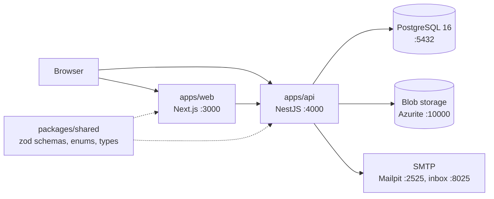

# Architecture

Current state of the repository. Feature scope is in [SPEC.md](SPEC.md); decisions are in [adr/](adr/).

## Overview

## Workspaces

| Path              | Package              | Role                                                        |
| ----------------- | -------------------- | ----------------------------------------------------------- |
| `apps/web`        | `@iconbridge/web`    | Next.js App Router, Tailwind CSS 4, shadcn/ui (RTL enabled) |
| `apps/api`        | `@iconbridge/api`    | NestJS 12 REST API (ESM), Prisma 7                          |
| `packages/shared` | `@iconbridge/shared` | zod schemas, enums and inferred types used by both apps     |
| `packages/config` | `@iconbridge/config` | ESLint, Prettier and tsconfig presets                       |
| `infra/terraform` | -                    | Azure infrastructure (empty for now)                        |

`packages/shared` is compiled to `dist/` (ESM + type declarations). Both apps import the compiled output, so it is built first; Turborepo handles the order.

## API

| URL             | Purpose                                                                                                 |
| --------------- | ------------------------------------------------------------------------------------------------------- |
| `/api/v1/*`     | Business endpoints (global prefix)                                                                      |
| `/api/docs`     | Swagger UI; OpenAPI JSON at `/api/docs-json`                                                            |
| `/health/live`  | Liveness: always 200 while the process runs                                                             |
| `/health/ready` | Readiness: 200 with `{"status":"ok","checks":{"database":"ok"}}`, 503 when the database does not answer |

The health endpoints are outside the `/api/v1` prefix so container probes keep a stable, unversioned path.

Structure of `apps/api/src`:

| File            | Role                                                                             |
| --------------- | -------------------------------------------------------------------------------- |
| `main.ts`       | Starts the server                                                                |
| `app.setup.ts`  | Prefix, CORS, Swagger. Shared by `main.ts` and the e2e tests                     |
| `config/env.ts` | zod schema of the environment; the app refuses to start if a variable is missing |
| `prisma/`       | `PrismaService` (global module), connects on first query                         |
| `health/`       | Probe endpoints                                                                  |
| `generated/`    | Prisma client, generated, git-ignored                                            |

## Configuration

| File            | Read by              | Validation                                        |
| --------------- | -------------------- | ------------------------------------------------- |
| `.env` (root)   | `docker-compose.yml` | Optional: every variable has a default            |
| `apps/api/.env` | API, Prisma CLI      | `apps/api/src/config/env.ts`, at startup          |
| `apps/web/.env` | Next.js              | `apps/web/src/lib/env.ts`, at dev start and build |

Each has a documented `.env.example`. `pnpm env:init` copies the examples to `.env` files that do not exist yet.

## Local services

| Service  | Image                                     | Host port                      | Notes                                                        |
| -------- | ----------------------------------------- | ------------------------------ | ------------------------------------------------------------ |
| postgres | `postgres:16-alpine`                      | 5432                           | Volume `postgres-data`                                       |
| azurite  | `mcr.microsoft.com/azure-storage/azurite` | 10000                          | Blob only, volume `azurite-data`                             |
| mailpit  | `axllent/mailpit`                         | 2525 (SMTP), 8025 (UI and API) | Host port 1025 is reserved by Windows on the dev workstation |
| pgadmin  | `dpage/pgadmin4`                          | 5050                           | Only with `docker compose --profile tools up -d`             |

All ports are bound to 127.0.0.1 and every service has a health check; `pnpm dev` waits for them.

## Testing

| Workspace         | Runner             | Scope today                                                                 |
| ----------------- | ------------------ | --------------------------------------------------------------------------- |
| `packages/shared` | Vitest             | Enums and schemas                                                           |
| `apps/api`        | Vitest + supertest | Environment validation; health endpoints over HTTP with the database mocked |
| `apps/web`        | Vitest             | Environment validation                                                      |

## Not built yet

Data model, authentication, file upload, email sending, i18n, Dockerfiles, Terraform and CI/CD.
