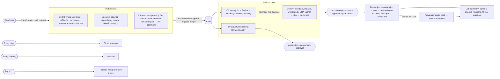

# CI/CD

GitHub Actions builds, tests, scans and deploys IconBridge Jobs. Choices and risks: [ADR-018](adr/ADR-018-ci-cd.md). Azure infrastructure: [DEPLOYMENT.md](DEPLOYMENT.md).



## Workflows

| File           | When                                                      | What                                                                                                                                                                                                                                                                                                                                                                                                                                                                                                                                                          |
| -------------- | --------------------------------------------------------- | ------------------------------------------------------------------------------------------------------------------------------------------------------------------------------------------------------------------------------------------------------------------------------------------------------------------------------------------------------------------------------------------------------------------------------------------------------------------------------------------------------------------------------------------------------------- |
| `ci.yml`       | Pull request, push on main, every night at 02:00, by hand | `checks`: format, lint, typecheck, unit tests. `api-e2e`: PostgreSQL service, Azurite, `pnpm test:cov` (API unit and e2e, shared, web libraries, thresholds). `browser`: PostgreSQL, Mailpit, Azurite, migrations and development data, build, Playwright (it starts the built API without rate limits and the web app). Chromium on every pull request; Firefox and WebKit (Playwright container, HTTPS) on main, at night and by hand. Coverage and Playwright reports are artifacts. Turborepo cache; a newer run cancels the older one of the same branch |
| `security.yml` | Pull request, push on main, every Monday                  | CodeQL (security-extended), dependency review (pull requests, fails on high), gitleaks on the whole history, trivy fs (SARIF to code scanning; fails on a fixable HIGH or CRITICAL)                                                                                                                                                                                                                                                                                                                                                                           |
| `infra.yml`    | Changes under `infra/`                                    | Static checks (`make tf-check`). Pull request: `terraform plan` (read-only identity, no lock), posted as a comment that is updated on each push. Main: plan and apply in the `production` environment, after approval                                                                                                                                                                                                                                                                                                                                         |
| `deploy.yml`   | CI green after a push on main; by hand                    | Builds the three images (tag = full git SHA, never `latest`), scans them (a fixable HIGH or CRITICAL stops the deployment before anything is pushed), pushes them. Then, after approval: migration job and wait, new revisions of the API and the web app, tasks job image, smoke test, automatic rollback on failure, summary                                                                                                                                                                                                                                |
| `release.yml`  | Tag `v*.*.*`                                              | GitHub release with notes generated from the merged pull requests (`.github/release.yml`)                                                                                                                                                                                                                                                                                                                                                                                                                                                                     |

Dependabot (`.github/dependabot.yml`) opens weekly pull requests for npm (grouped minor and patch), the two Dockerfiles, the GitHub Actions (all pinned to a commit SHA) and the three Terraform roots.

## Azure sign-in

No password or client secret: each workflow exchanges GitHub's OpenID Connect token for an Azure token. Three Entra app registrations, created by `infra/terraform/github` (applied by the owner only):

| Identity | GitHub secret                                   | Federated subject        | Rights                                                                                                                                                            |
| -------- | ----------------------------------------------- | ------------------------ | ----------------------------------------------------------------------------------------------------------------------------------------------------------------- |
| plan     | `AZURE_CLIENT_ID_PLAN`                          | `pull_request`           | Reader on `rg-iconbridge-prod`; Reader and Storage Blob Data Reader on the state; Key Vault Secrets User; Storage Blob Data Reader on the files                   |
| push     | `AZURE_CLIENT_ID_PUSH`                          | `ref:refs/heads/main`    | AcrPush on the registry                                                                                                                                           |
| deploy   | `AZURE_CLIENT_ID` (secret of `production` only) | `environment:production` | Contributor on `rg-iconbridge-prod`; Reader and Storage Blob Data Contributor on the state; Key Vault Secrets Officer; Storage Blob Data Contributor on the files |

None of them can assign roles. A production change that adds a role assignment fails in `infra.yml` at that resource; the owner applies it with `make tf-apply ENV=prod`.

## GitHub settings

| Setting                     | Value                                                                                                                                                                                                                                          |
| --------------------------- | ---------------------------------------------------------------------------------------------------------------------------------------------------------------------------------------------------------------------------------------------- |
| Visibility                  | Public (branch protection, environment reviewers and CodeQL are not available on a private repository of a free account)                                                                                                                       |
| Branch protection of `main` | Pull request required, the checks `Lint, types, unit tests`, `API e2e and coverage`, `Browser tests (chromium)` and `Secrets in the history (gitleaks)` must pass on an up-to-date branch, no force push, no deletion, also for administrators |
| Environment `production`    | Required reviewer: the owner; deployable from `main` only; secret `AZURE_CLIENT_ID`                                                                                                                                                            |
| Repository secrets          | `AZURE_TENANT_ID`, `AZURE_SUBSCRIPTION_ID`, `AZURE_CLIENT_ID_PLAN`, `AZURE_CLIENT_ID_PUSH`, `TF_VARS_PROD` (the git-ignored `terraform.tfvars`), `TURNSTILE_SITE_KEY` (build argument of the web image)                                        |
| Repository variables        | `REGISTRY_TYPE` (`acr` or `ghcr`), `ACR_NAME`, `SITE_URL`                                                                                                                                                                                      |
| Pull requests               | Template `.github/pull_request_template.md`; code owner: the owner (`.github/CODEOWNERS`)                                                                                                                                                      |

Set up once (owner, after `az login`):

```bash
make tf-init ENV=github && make tf-plan ENV=github && make tf-apply ENV=github
# then the secrets: see the journal entry of 16 October 2026 for the exact commands
```

## Deploying

1. Merge a pull request whose checks are green. CI runs on main; when it succeeds, `deploy.yml` builds, scans and pushes the images. A merge that only changes documentation (`docs/**`, `*.md`) deploys nothing.
2. GitHub asks the reviewer of `production` to approve (Actions → the run → Review deployments).
3. The deploy job runs the migration job and waits for it, updates the API, the web app and the tasks job, waits until the new revisions are the apps' latest ready revisions (`.github/scripts/wait-revisions.sh`, 6 minutes at most: until then the old revisions keep the traffic), then runs the smoke test (`.github/scripts/smoke-test.sh`: within 5 minutes, the time of a cold start, `/api/health/ready` answers `ok` with the deployed commit for both the web app and the API, and `/en` renders).
4. If any of this fails, the previous images are put back (single revision mode: a new revision with the previous images), waited for and checked again. Migrations are not undone: they must work with the previous version (CLAUDE.md).

The apps report the commit they run (`APP_VERSION`, set by the Dockerfiles from `VCS_REF`) in their health answers: `/api/health/live` (web), `/health/live` and `/health/ready` (API), and `/api/health/ready` gives both. Images built before 19 October 2026 report none: the smoke test then relies on the revision wait and says so.

By hand (Actions → Deploy → Run workflow):

- `image_tag`: deploys existing images (a full git SHA) without building, e.g. to go back to a known version;
- `force_smoke_failure`: makes the smoke test fail after its checks, to exercise the rollback.

## Releases

```bash
git switch main && git pull
git tag -a v1.0.0 -m "v1.0.0" && git push origin v1.0.0
```

## Troubleshooting

| Symptom                                                             | Cause and fix                                                                                                                                                        |
| ------------------------------------------------------------------- | -------------------------------------------------------------------------------------------------------------------------------------------------------------------- |
| `AADSTS70021: No matching federated identity record found`          | The job's subject is not one of the three: a deploy step outside the `production` environment, or a workflow on another branch. Check `environment:` and the trigger |
| `terraform apply` in CI: `AuthorizationFailed` on a role assignment | Expected: CI cannot assign roles. Apply that change locally (`make tf-apply ENV=prod`)                                                                               |
| The plan comment says `Plan failed` on a pull request from a fork   | Forks get no OIDC token: the plan job is skipped for them on purpose                                                                                                 |
| Deploy waits forever                                                | It waits for the approval of `production` (Review deployments)                                                                                                       |
| Smoke test fails on the first deploy after a long pause             | It waits up to 5 minutes for a cold start; beyond that, read the revision's logs (`az containerapp logs show`)                                                       |
