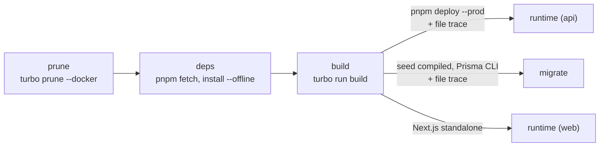

# Deployment

How the container images of IconBridge Jobs are built, checked and run: on this machine with `docker-compose.prod.yml`, then in Azure Container Apps. The Azure resources themselves (Terraform) and the CI/CD pipeline are not written yet; this document gives what they need.

## Images

| Image                | Dockerfile (target)             | Runs                                                      | Size (uncompressed / to pull) |
| -------------------- | ------------------------------- | --------------------------------------------------------- | ----------------------------- |
| `iconbridge-api`     | `apps/api/Dockerfile`           | The API, port 4000 (`node dist/main.js`)                  | 203 MB / 66 MB                |
| `iconbridge-migrate` | `apps/api/Dockerfile` `migrate` | `prisma migrate deploy`, then the seed of reference data  | 259 MB / 90 MB                |
| `iconbridge-web`     | `apps/web/Dockerfile`           | The Next.js server, port 3000 (`node apps/web/server.js`) | 166 MB / 63 MB                |
| `iconbridge-backup`  | `infra/backup/Dockerfile`       | Weekly `pg_dump` uploaded to the `backups` container      | 30 MB / 9 MB                  |

The scheduled tasks use the API image with another command: `node dist/cli.js all`.

The three application images (the backup image is plain Alpine with the PostgreSQL 16 client, curl and jq, user 1000: [ADR-020](adr/ADR-020-backups.md)):

- run as user 1000 (`node`), never root, with `node` as process 1 so it receives SIGTERM;
- start from `alpine:3.22` with Alpine's Node 22 package and the full ICU data (dates in French and Arabic); no npm, yarn or pnpm in the final image;
- carry the labels `org.opencontainers.image.source`, `revision` and `created` (build arguments `VCS_REF` and `BUILD_DATE`).

Sizes are measured from the image layers. Docker Desktop with the containerd image store shows larger numbers in `docker images` (about 290, 360 and 235 MB), because it adds the compressed copy of each layer to the unpacked one.

### How they are built



1. **prune**: `turbo prune <app> --docker` keeps the app, the workspace packages it uses, and a lockfile reduced to them.
2. **deps**: `pnpm fetch` needs only the lockfile, so this layer is rebuilt only when dependencies change; then `pnpm install --offline --frozen-lockfile`.
3. **build**: `turbo run build` builds `packages/shared`, generates the Prisma client and compiles the app.
4. **API runtime**: `pnpm deploy --prod` gives the production dependencies in a flat folder; `apps/api/scripts/trace-runtime.mjs` then keeps only the files that `dist/main.js` and `dist/cli.js` load (with `@vercel/nft`, the tracer of Next.js). This takes `node_modules` from 721 MB to 75 MB: the Prisma CLI and its studio arrive as peers of the client, and many packages ship code for every platform.
5. **migrate**: the seed is compiled to JavaScript (`tsconfig.seed.json`); the trace keeps it, the Prisma CLI and its engines. The sample data (Faker) is not in it.
6. **web**: `NEXT_OUTPUT=standalone` makes Next.js write a server with only the files it needs; the static assets and `public/` are copied next to it.

Prisma 7 with the PostgreSQL driver adapter has no native query engine: the client is TypeScript compiled into `dist/`, so there is no binary target to choose for Alpine. The migration image carries the schema engine of the Prisma CLI for `linux-musl`.

## Build

From the repository root:

```bash
REF=$(git rev-parse --short HEAD)
NOW=$(date -u +%Y-%m-%dT%H:%M:%SZ)

docker build -f apps/api/Dockerfile -t iconbridge-api:$REF \
  --build-arg VCS_REF=$REF --build-arg BUILD_DATE=$NOW .

docker build -f apps/api/Dockerfile --target migrate -t iconbridge-migrate:$REF \
  --build-arg VCS_REF=$REF --build-arg BUILD_DATE=$NOW .

docker build -f apps/web/Dockerfile -t iconbridge-web:$REF \
  --build-arg VCS_REF=$REF --build-arg BUILD_DATE=$NOW \
  --build-arg NEXT_PUBLIC_SITE_URL=https://jobs.example.com \
  --build-arg NEXT_PUBLIC_TURNSTILE_SITE_KEY=<site key> .
```

`NEXT_PUBLIC_*` values are written into the JavaScript sent to browsers, so they are fixed when the web image is built: build one web image per public address (staging, production). Everything else is read when the containers start.

## Check

```bash
# Dockerfiles
docker run --rm -i hadolint/hadolint < apps/api/Dockerfile
docker run --rm -i hadolint/hadolint < apps/web/Dockerfile

# Images: fail on a HIGH or CRITICAL vulnerability that has a fix
for image in iconbridge-api iconbridge-migrate iconbridge-web; do
  trivy image --scanners vuln --severity HIGH,CRITICAL --ignore-unfixed --exit-code 1 $image:$REF
done
```

Results on 14 October 2026: hadolint without remark on both files; trivy found no fixable high or critical vulnerability in the three images.

## Run the production images on this machine

`docker-compose.prod.yml` runs the three images against the local PostgreSQL, Azurite and Mailpit, with the same data as `pnpm dev`:

```bash
# pnpm dev uses ports 3000 and 4000: stop it first.
docker compose -f docker-compose.prod.yml up --build
```

| Step         | What happens                                                                                    |
| ------------ | ----------------------------------------------------------------------------------------------- |
| 1. Services  | PostgreSQL, Azurite and Mailpit of `docker-compose.yml` start (or are already running)          |
| 2. `migrate` | Applies the migrations, creates reference data and the first super admin if missing, then exits |
| 3. `api`     | Starts when `migrate` succeeded; healthy when `/health/ready` answers                           |
| 4. `web`     | Starts when the API is healthy                                                                  |

Then: the site on <http://localhost:3000>, the API docs on <http://localhost:4000/api/docs>, the emails in Mailpit on <http://localhost:8025>.

Secrets come from the local `apps/api/.env` and `apps/web/.env` (`pnpm env:init`); the compose file only changes what differs inside Docker (host names, ports). Differences with production, all on purpose:

- `NODE_ENV=test` for the API container: `production` refuses the Turnstile test keys and SMTP without TLS (Mailpit). Everything else behaves as in production.
- Azurite is reached as `azurite.localhost`: the API signs download links with that name, and browsers send every `*.localhost` name to this machine. Chromium, Firefox and Edge do; Safari does not.
- The scheduled tasks do not run by themselves (`SCHEDULER_ENABLED=false`, as in Azure). Run them like the Azure job does:

  ```bash
  docker compose -f docker-compose.prod.yml run --rm --no-deps api node dist/cli.js all
  ```

- The browser tests can run against these containers. Rate limits must be off, because every test signs in from this machine:

  ```bash
  RATE_LIMITS_ENABLED=false docker compose -f docker-compose.prod.yml up -d --build --wait
  pnpm test:browser
  ```

Stop with `docker compose -f docker-compose.prod.yml down` (the volumes, and so the data, stay).

## Azure Container Apps

Region, quotas, budget and the identity of the pipeline are in [00-environment.md](00-environment.md).

### Order of a deployment

1. Build, scan and push the three images to Azure Container Registry, tagged with the git commit.
2. Start the Container Apps Job `migrate` with the new image tag and wait for it to succeed. Migrations must stay backward compatible with the running API (add columns, then remove them in a later release), because the old revision serves traffic until step 3 ends.
3. Update the API, then the web app, to the new tag. Container Apps starts the new revision, waits for its readiness probe, then moves the traffic and stops the old one (SIGTERM).
4. Update the tasks job to the new API tag and the backup job to the new backup tag.

### Container Apps

| Setting           | API                                                                       | Web                                                     |
| ----------------- | ------------------------------------------------------------------------- | ------------------------------------------------------- |
| Image             | `iconbridge-api:<commit>`                                                 | `iconbridge-web:<commit>`                               |
| Ingress           | Internal only, target port 4000                                           | External, HTTPS only, target port 3000                  |
| Liveness probe    | `GET /health/live`, every 30 s                                            | `GET /api/health/live`, every 30 s                      |
| Readiness probe   | `GET /health/ready` (checks the database), every 3 s, 3 s timeout         | `GET /api/health/live`, every 3 s                       |
| Startup probe     | `GET /health/live` every second, up to 60 s                               | `GET /api/health/live` every second, up to 60 s         |
| Size              | 0.5 vCPU / 1 GiB                                                          | 0.5 vCPU / 1 GiB ([ADR-017](adr/ADR-017-cold-start.md)) |
| Scale             | 0 to 2 replicas, HTTP rule                                                | 0 to 2 replicas, HTTP rule                              |
| Termination grace | 30 s (longer than the emails in progress)                                 | 30 s                                                    |
| Identity          | Managed identity: Blob Storage, Key Vault, Communication Services (email) | —                                                       |

The browser never calls the API host: the web app forwards `/api/v1/*` to `API_INTERNAL_URL`, the internal address of the API app.

### Container Apps Jobs

| Job       | Image                         | Trigger                                        | Command                      |
| --------- | ----------------------------- | ---------------------------------------------- | ---------------------------- |
| `migrate` | `iconbridge-migrate:<commit>` | Manual, by the pipeline before each deployment | default (`CMD` of the image) |
| `tasks`   | `iconbridge-api:<commit>`     | Schedule `*/15 * * * *`                        | `node dist/cli.js all`       |
| `backup`  | `iconbridge-backup:<commit>`  | Schedule `0 3 * * 0` (Sunday 03:00 UTC)        | `backup.sh` (`ENTRYPOINT`)   |

The task job sends the emails the API could not send at once, closes expired jobs, sends job alerts and applies the retention rules. Each task takes a PostgreSQL advisory lock, so two runs never overlap. Emails do not wait for this job: the API sends each one right after its database transaction, and the job only retries those that failed (`apps/api/test/e2e/email-immediate.e2e-spec.ts`).

### Configuration

Secrets are Key Vault references in Container Apps, never plain values in the template.

**API** (`apps/api/.env.example` documents each variable):

| Variable                                                                             | Production value                                                                                                                                                               |
| ------------------------------------------------------------------------------------ | ------------------------------------------------------------------------------------------------------------------------------------------------------------------------------ |
| `NODE_ENV`                                                                           | `production` (set in the image)                                                                                                                                                |
| `PORT`                                                                               | `4000` (set in the image)                                                                                                                                                      |
| `WEB_ORIGIN`                                                                         | Public address of the site, e.g. `https://jobs.example.com`                                                                                                                    |
| `WEB_INTERNAL_URL`                                                                   | Internal address of the web app, for cache invalidation                                                                                                                        |
| `DATABASE_URL`                                                                       | Secret. PostgreSQL Flexible Server, `sslmode=require`                                                                                                                          |
| `AZURE_STORAGE_ACCOUNT_URL`                                                          | `https://<account>.blob.core.windows.net` (managed identity); `AZURE_STORAGE_CONNECTION_STRING` empty                                                                          |
| `PUBLIC_MEDIA_BASE_URL`                                                              | Public URL of the `public-media` container (or the CDN in front of it)                                                                                                         |
| `PASSPORT_ENCRYPTION_KEY`                                                            | Secret. 32 bytes, base64. Losing it makes every stored passport number unreadable                                                                                              |
| `JWT_ACCESS_SECRET`                                                                  | Secret, at least 32 characters                                                                                                                                                 |
| `REVALIDATE_SECRET`                                                                  | Secret, the same value in the web app                                                                                                                                          |
| `TURNSTILE_SECRET_KEY`                                                               | Secret. The real key (test keys are refused in production)                                                                                                                     |
| `EMAIL_TRANSPORT`, `AZURE_COMMUNICATION_ENDPOINT`, `MAIL_FROM`, `EMAIL_HOURLY_QUOTA` | `azure`, the Communication Service's endpoint, `DoNotReply@<Azure-managed domain>`. No SMTP setting or password ([ADR-014](adr/ADR-014-email-azure-communication-services.md)) |
| `TRUST_PROXY_HOPS`                                                                   | The proxies in front of the API (see below)                                                                                                                                    |
| `SCHEDULER_ENABLED`                                                                  | `false`: the `tasks` job runs the tasks                                                                                                                                        |
| `MAIL_DELIVERY`                                                                      | `background` (default)                                                                                                                                                         |

**Migration job**: `DATABASE_URL`, `PASSPORT_ENCRYPTION_KEY`, `SEED_ADMIN_EMAIL`, `SEED_ADMIN_PASSWORD` (secret; used only when no super admin exists yet). `NODE_ENV=production` is set in the image, so no sample data is ever written.

**Web**: `API_INTERNAL_URL` (internal address of the API), `CSP_MEDIA_ORIGINS` (`https://<account>.blob.core.windows.net`, plus the CDN if any), `REVALIDATE_SECRET` (secret). The `NEXT_PUBLIC_*` values are build arguments (see [Build](#build)).

`TRUST_PROXY_HOPS` must equal the number of proxies that add themselves to `X-Forwarded-For` between the visitor and the API (the external ingress, the web app, the internal ingress of the API). Too low, and every visitor shares the address of a proxy for the rate limits; too high, and a visitor can choose their own address. Check it on the first deployment: sign in once and read the address in the audit log, which must be yours.

### Shutdown

Container Apps sends SIGTERM to process 1, then SIGKILL after the grace period.

- **API**: stops accepting requests, finishes those in progress and the emails being sent, closes the mail (SMTP locally) and database connections, exits with 0. Measured locally: 0.6 s.
- **Web**: Next.js stops accepting requests, waits for those in progress, then exits with 143 (128 + SIGTERM), on purpose.

## Runbook: Azure with Terraform

The infrastructure is in `infra/terraform` (see [ADR-013](adr/ADR-013-azure-infrastructure.md) and the diagram in [ARCHITECTURE.md](ARCHITECTURE.md#azure-infrastructure)). Every command runs from the repository root, signed in with `az login`; the Make targets load `.azure-context`.

Names below are those of production in Italy North: resource group `rg-iconbridge-prod`, registry `acriconbridgeproditn`, vault `kv-iconbridge-prod-itn`, apps `ca-iconbridge-api-prod-itn` and `ca-iconbridge-web-prod-itn`, jobs `caj-iconbridge-migrate-prod-itn` and `caj-iconbridge-tasks-prod-itn`.

### 1. State storage (once)

```bash
echo 'owner = "you@example.com"' > infra/terraform/bootstrap/terraform.tfvars
make tf-bootstrap
```

Creates `rg-iconbridge-tfstate` and the storage account `sticonbridgetfstateitn` (container `tfstate`, versioning, soft delete, no account key). Its own state stays in `infra/terraform/bootstrap/terraform.tfstate` on this machine (git-ignored): keep a copy somewhere safe.

### 2. Infrastructure

```bash
cp infra/terraform/envs/prod/terraform.tfvars.example infra/terraform/envs/prod/terraform.tfvars
# owner_email, admin_ip_addresses (curl -s https://api.ipify.org)
az provider register --namespace Microsoft.Communication --wait   # once, for the email resources
make tf-init ENV=prod
make tf-plan ENV=prod      # read the plan
make tf-apply ENV=prod     # only after approval
terraform -chdir=infra/terraform/envs/prod output
```

The apps start with Microsoft's public placeholder images and scale to zero; nothing runs yet. The environment is created in `ConsumptionOnly` mode with azapi: an Express environment (Azure's default for a request without a mode since October 2026) refuses Key Vault references and Jobs ([ADR-015](adr/ADR-015-container-apps-environment-mode.md)).

**Sender name of the emails** (once): Azure creates the sender `DoNotReply` with the managed domain, so Terraform cannot set its display name in the same apply. The command is in an output:

```bash
eval "$(terraform -chdir=infra/terraform/envs/prod output -raw mail_display_name_command)"
terraform -chdir=infra/terraform/envs/prod output -raw mail_sender   # DoNotReply@<guid>.azurecomm.net
```

### 3. External secrets

The API refuses the Turnstile test keys in production. Two secrets are created with the value `CHANGE_ME` and must be set by hand: `turnstile-site-key` and `turnstile-secret-key` (and `ghcr-pull-token` with `registry_type = "ghcr"`). Email needs no secret: the API sends through Azure Communication Services with its managed identity.

**Cloudflare Turnstile (free)**

1. Open <https://dash.cloudflare.com/sign-up>, create the account and confirm the email.
2. Left menu → **Turnstile** → **Add widget**.
3. Widget name `IconBridge Jobs`. **Hostname management** → **Add hostnames**: the web app's address without `https://` (`terraform -chdir=infra/terraform/envs/prod output -raw web_default_fqdn`), and the custom domain if there is one.
4. Widget mode **Managed**; pre-clearance **No**. **Create**.
5. Copy the **Site Key** and the **Secret Key**.

**Into Key Vault** (values are typed, not left in the shell history):

```bash
VAULT=kv-iconbridge-prod-itn
for name in turnstile-site-key turnstile-secret-key; do
  read -rsp "$name: " value; echo
  az keyvault secret set --vault-name $VAULT --name $name --value "$value" --output none
done
unset value
```

Terraform ignores these values afterwards. A Container App reads its secrets when a revision starts: after changing one, restart it (`az containerapp revision restart`, or deploy a new image).

### 4. Images

```bash
OUT=infra/terraform/envs/prod
REGISTRY=$(terraform -chdir=$OUT output -raw registry_login_server)
SITE=https://$(terraform -chdir=$OUT output -raw web_default_fqdn)
SITE_KEY=$(az keyvault secret show --vault-name kv-iconbridge-prod-itn --name turnstile-site-key --query value -o tsv)
REF=$(git rev-parse --short HEAD); NOW=$(date -u +%Y-%m-%dT%H:%M:%SZ)

az acr login --name acriconbridgeproditn
docker build -f apps/api/Dockerfile -t $REGISTRY/iconbridge-api:$REF --build-arg VCS_REF=$REF --build-arg BUILD_DATE=$NOW .
docker build -f apps/api/Dockerfile --target migrate -t $REGISTRY/iconbridge-migrate:$REF --build-arg VCS_REF=$REF --build-arg BUILD_DATE=$NOW .
docker build -f apps/web/Dockerfile -t $REGISTRY/iconbridge-web:$REF --build-arg VCS_REF=$REF --build-arg BUILD_DATE=$NOW \
  --build-arg NEXT_PUBLIC_SITE_URL=$SITE --build-arg NEXT_PUBLIC_TURNSTILE_SITE_KEY=$SITE_KEY .
for image in iconbridge-api iconbridge-migrate iconbridge-web; do docker push $REGISTRY/$image:$REF; done
```

### 5. Migrate, then deploy

```bash
RG=rg-iconbridge-prod
az containerapp job update -g $RG -n caj-iconbridge-migrate-prod-itn --image $REGISTRY/iconbridge-migrate:$REF
az containerapp job start -g $RG -n caj-iconbridge-migrate-prod-itn
az containerapp job execution list -g $RG -n caj-iconbridge-migrate-prod-itn --query "[0].properties.status" -o tsv   # wait for Succeeded

az containerapp update -g $RG -n ca-iconbridge-api-prod-itn --image $REGISTRY/iconbridge-api:$REF
az containerapp update -g $RG -n ca-iconbridge-web-prod-itn --image $REGISTRY/iconbridge-web:$REF
az containerapp job update -g $RG -n caj-iconbridge-tasks-prod-itn --image $REGISTRY/iconbridge-api:$REF
```

The logs of a job execution are in Log Analytics (`ContainerAppConsoleLogs_CL`), or `az containerapp job logs show`.

### 6. Verify

```bash
curl -s -o /dev/null -w '%{http_code}\n' $SITE/en           # 200 (the first request wakes both apps)
curl -s $SITE/api/health/ready                              # {"status":"ok"}: the API and its database
make tf-plan ENV=prod                                       # "No changes"
```

Then, in a browser: register, upload a CV, and check that the file is in the storage:

```bash
az storage blob list --auth-mode login --account-name sticonbridgeproditn -c candidate-documents --query "[].name" -o tsv
```

**Email**: register with an address you can read. The verification email comes from `IconBridge Recruitment <DoNotReply@…azurecomm.net>`; look in the spam folder the first time. The outbox state is in the database (`email_outbox`), and the sends in the API logs (`Email sent: verify-email (en)`).

**Email quota**: an Azure-managed domain sends at most 5 emails a minute and 10 an hour for the whole subscription, and this cannot be raised. Over it, Azure answers 429; the outbox waits as long as asked without spending an attempt (log `Email delayed`). Account emails go first, then application emails, then the rest, and job alerts never use more than 5 of the 10 emails of an hour (`EMAIL_HOURLY_QUOTA`), so a burst of job alerts leaves over several hours without delaying a verification email. For more, connect a verified custom domain to the Email Communication Service (DNS records for SPF and DKIM) and ask for a quota increase ([ADR-014](adr/ADR-014-email-azure-communication-services.md)).

**First super admin**: the address is `owner_email`; the password is in the vault. Sign in, then change it in the account settings at once.

```bash
az keyvault secret show --vault-name kv-iconbridge-prod-itn --name seed-admin-password --query value -o tsv
```

**TRUST_PROXY_HOPS**: after a sign-in, the back office's audit log shows the address of the request. It must be your public address. If it is an address of Azure, raise `trust_proxy_hops`; if you could choose it with an `X-Forwarded-For` header, lower it.

### Routine deployment

Through GitHub Actions since 16 October 2026: merge a pull request, approve the `production` deployment, and `deploy.yml` builds, scans, migrates, deploys, smoke-tests and rolls back on failure ([CICD.md](CICD.md)). Steps 4 and 5 above stay the manual fallback. Migrations must work with the API still running (see CLAUDE.md).

### After the free year of the registry

Set `registry_type = "ghcr"`, `ghcr_owner` and `ghcr_username` in `terraform.tfvars`; create a GitHub token with only `read:packages`; apply; set the secret `ghcr-pull-token`; push the images to `ghcr.io/<owner>/…`; deploy with the new names. Then the registry can be removed from the plan.

### Custom domain (optional)

1. At the DNS provider: a CNAME from the domain to the web app's default address (`terraform -chdir=infra/terraform/envs/prod output -raw web_default_fqdn`) and a TXT record `asuid.<domain>` with `terraform -chdir=infra/terraform/envs/prod output -raw custom_domain_verification_id`.
2. In `terraform.tfvars`: `enable_custom_domain = true` and `custom_domain = "jobs.example.com"`; plan and apply. Terraform adds the host name to the web app and asks Azure for a free managed certificate (validated through the CNAME; it can take several minutes).
3. Bind the certificate, once. The azurerm provider cannot do it; Terraform ignores the binding afterwards:

   ```bash
   OUT=infra/terraform/envs/prod
   az containerapp hostname bind -g rg-iconbridge-prod \
     -n "$(terraform -chdir=$OUT output -json container_app_names | jq -r .web)" \
     --hostname jobs.example.com \
     --environment cae-iconbridge-prod-itn \
     --certificate "$(terraform -chdir=$OUT output -raw managed_certificate_name)"
   ```

4. Rebuild the web image with `NEXT_PUBLIC_SITE_URL=https://<domain>`, add the domain to the Turnstile widget, and apply again (CORS and `WEB_ORIGIN` follow the domain).

### Costs

| Resource                               | List price (Italy North)             | Expected                                                                                                     |
| -------------------------------------- | ------------------------------------ | ------------------------------------------------------------------------------------------------------------ |
| PostgreSQL B1ms, 32 GB, 7-day backups  | ~0.023 USD/hour + storage            | 0 within the free 750 h and 32 GB a month                                                                    |
| Container Registry Standard            | 0.67 USD/day (about 20 USD a month)  | 0 within the free year, then ghcr                                                                            |
| Container Apps (apps and jobs)         | per vCPU-second, GiB-second, request | 0 within the monthly free grant (scale to zero; the tasks job uses about 22 000 vCPU-seconds of the 180 000) |
| Log Analytics and Application Insights | 2.99 USD/GB after 5 GB a month       | 0: capped at 0.15 GB a day                                                                                   |
| Storage (files and state)              | ~0.018 USD/GB a month                | a few cents                                                                                                  |
| Key Vault                              | 0.03 USD per 10 000 operations       | a few cents                                                                                                  |
| Budget, identity, resource groups      | free                                 | 0                                                                                                            |

The budget (15 USD a month) emails `owner_email` at 50, 80 and 100 %. The subscription's spending limit stops the resources when the credit is spent.

## Troubleshooting

| Symptom                                                                      | Cause and fix                                                                    |
| ---------------------------------------------------------------------------- | -------------------------------------------------------------------------------- |
| The API exits at start with "Invalid environment configuration"              | The listed variables are missing or malformed (their values are never printed)   |
| `migrate` fails with "Cannot seed: missing or invalid …"                     | The listed seed variables are missing                                            |
| Pictures do not show, the browser console names the CSP                      | `CSP_MEDIA_ORIGINS` of the web app does not list the storage address             |
| The public site shows changes a minute late                                  | `WEB_INTERNAL_URL` or `REVALIDATE_SECRET` differ between the API and the web app |
| Every visitor is rate-limited together                                       | `TRUST_PROXY_HOPS` is too low                                                    |
| Locally, `docker compose -f docker-compose.prod.yml up` says a port is taken | `pnpm dev` is still running                                                      |
