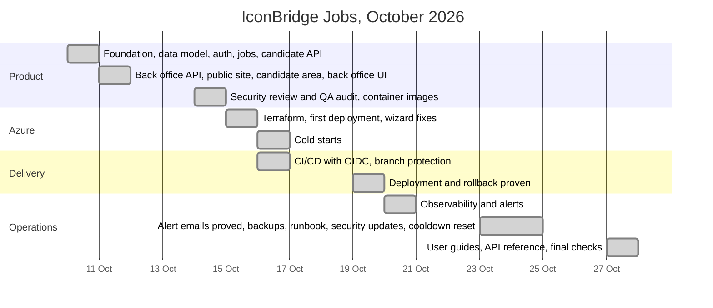

# Timeline of the internship

From the first commit (10 October 2026) to the production system with CI/CD, monitoring, backups and documentation (27 October 2026). Built from [JOURNAL.md](JOURNAL.md), which holds the details, checks and pull request of each step.

## Phases

| Dates         | Phase                         | What was delivered                                                                                                                                                                                                                                                 | Pull requests      |
| ------------- | ----------------------------- | ------------------------------------------------------------------------------------------------------------------------------------------------------------------------------------------------------------------------------------------------------------------ | ------------------ |
| 10 October    | Foundation and API            | pnpm + Turborepo monorepo, local stack (PostgreSQL, Azurite, Mailpit); data model with database constraints; authentication (argon2id, rotating refresh tokens, roles); job offers and search; candidate profile, documents and applications with the 6-month rule | #1–#5              |
| 11 October    | Back office and web app       | Back-office API (state machine, audit log, exports, scheduled tasks); public site in English, French and Arabic; candidate area; back office UI; historical results and deletions                                                                                  | #6–#11             |
| 14 October    | Hardening                     | OWASP review, QA report, coverage thresholds, k6 load tests; minimal container images (Alpine, user 1000, traced runtime files)                                                                                                                                    | #12–#13            |
| 15–16 October | Azure (Prompt 12)             | Terraform modules (Container Apps, PostgreSQL, Blob Storage, Key Vault, ACR, Communication Services email), first deployment, fixes from the first test in production, cold starts from 141 s to about 58 s                                                        | #14–#16            |
| 16–19 October | CI/CD (Prompt 13)             | GitHub Actions with three federated identities (no secrets), branch protection, approval of the `production` environment, smoke test bound to the new revision; a title change shipped end to end and a forced failure rolled back                                 | #17, #18, #27, #29 |
| 20–24 October | Operations (Prompt 14)        | OpenTelemetry and Application Insights, business events, workbook and alerts (proved by email); weekly `pg_dump` backups with a tested restore; runbook; super-admin cooldown reset; three rounds of dependency advisories fixed before any deployment             | #30–#32, #34, #38  |
| 27 October    | Documentation and final check | C4 diagrams, generated API reference with the access of every route, user guides with screenshots of test data, README, timeline; final checks against Azure                                                                                                       | this PR            |

## Milestones

| Date       | Milestone                                                                                                       |
| ---------- | --------------------------------------------------------------------------------------------------------------- |
| 10 October | First commit; every later change through a `feat/` branch and a pull request                                    |
| 14 October | Security review: OWASP Top 10 checklist, no known vulnerability in production dependencies                      |
| 15 October | First deployment on Azure (Italy North), within the 15 USD monthly budget                                       |
| 19 October | First change deployed by the pipeline after approval; automatic rollback proven                                 |
| 23 October | Forced server errors fire the alert email (Fired 12:32, Resolved 12:39, Tunis time); restore of a backup tested |
| 23 October | Critical Next.js advisory found by the build itself, patched and deployed the same day                          |
| 27 October | Documentation folder ready for the internship report                                                            |

## Figures at the end

| Measure                | Value                                                                  |
| ---------------------- | ---------------------------------------------------------------------- |
| API operations         | 120 ([API.md](API.md)), every one with its access rule tested          |
| Automated tests        | 618 unit, 516 API end-to-end, 153 browser (Chromium, Firefox, WebKit)  |
| Architecture decisions | 21 ADRs ([adr/](adr/))                                                 |
| Infrastructure         | 9 Terraform modules, applied by the pipeline after approval            |
| Monthly cost           | Within the 15 USD budget (free tiers; availability tests off, ADR-019) |
