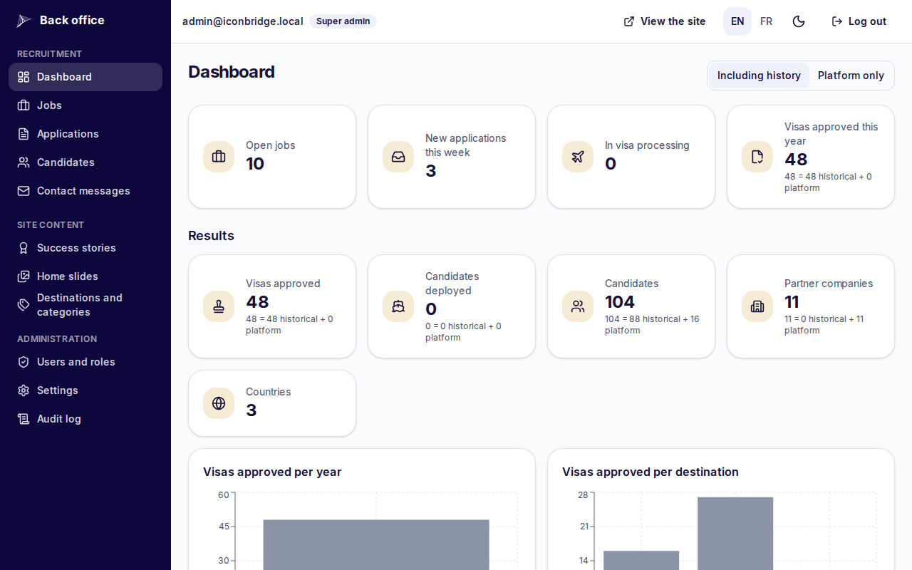
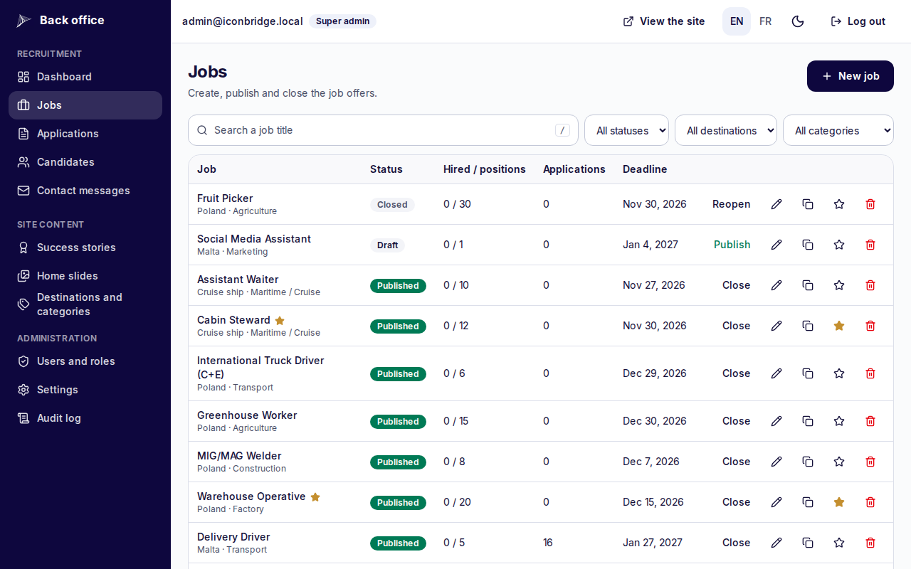
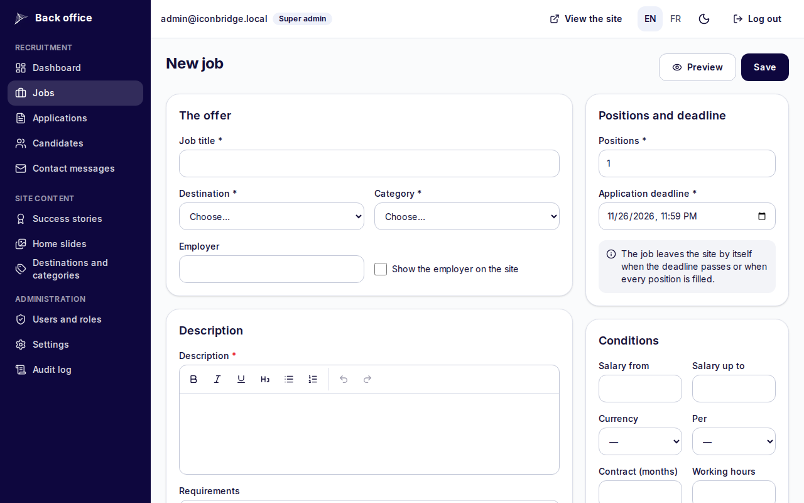
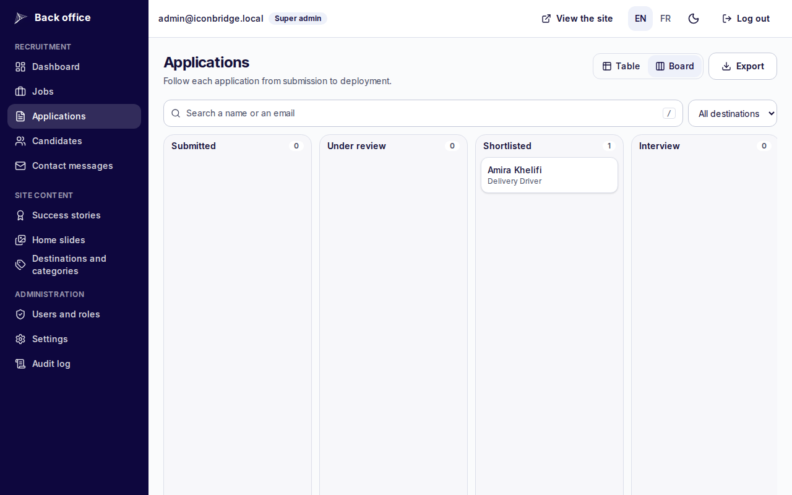
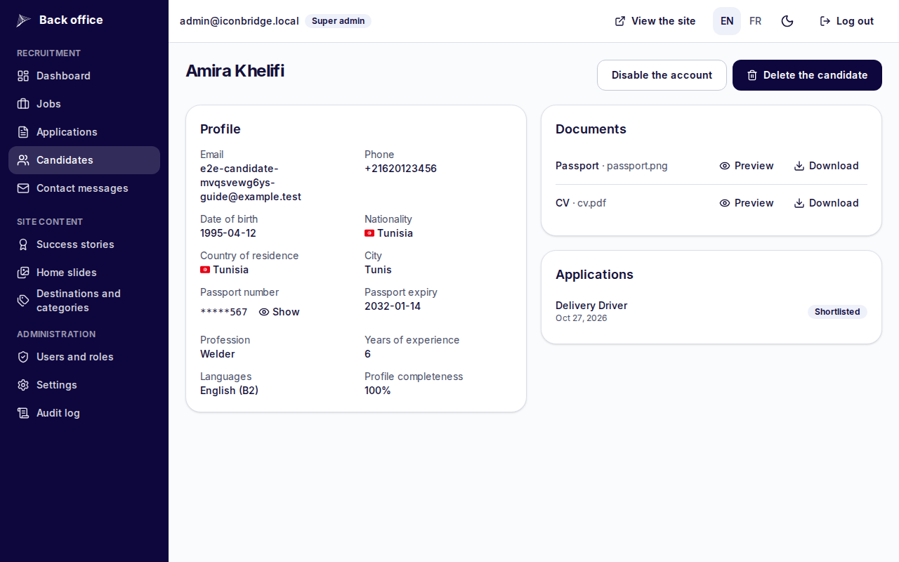
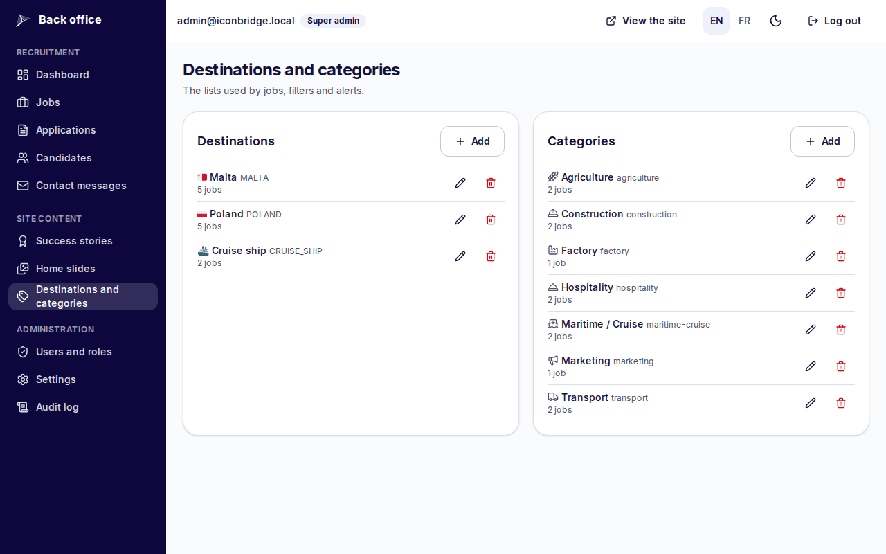
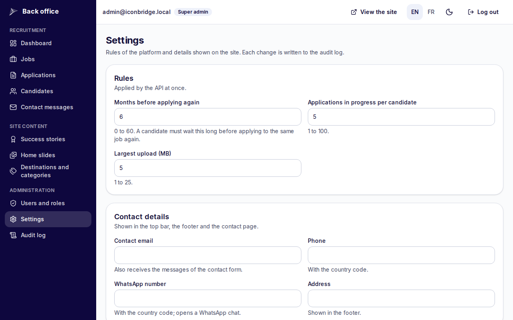
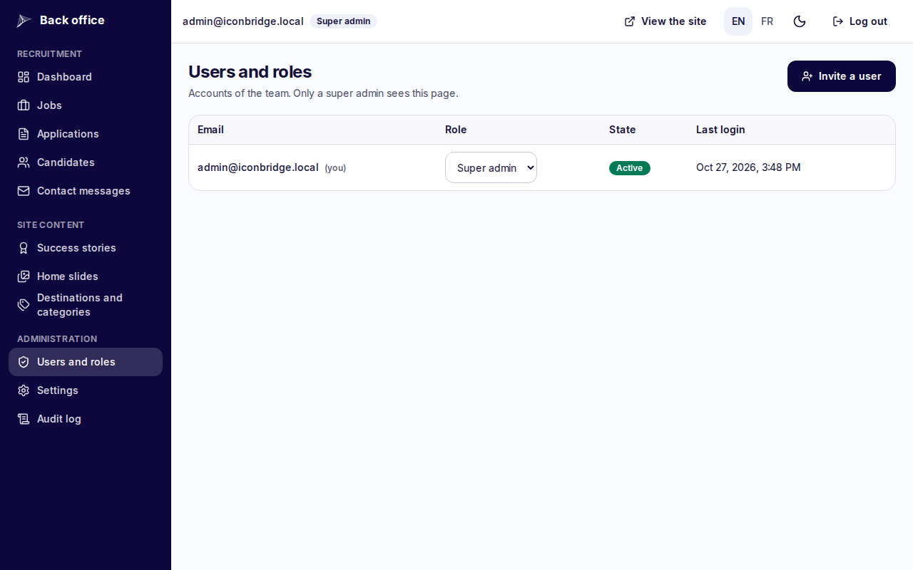
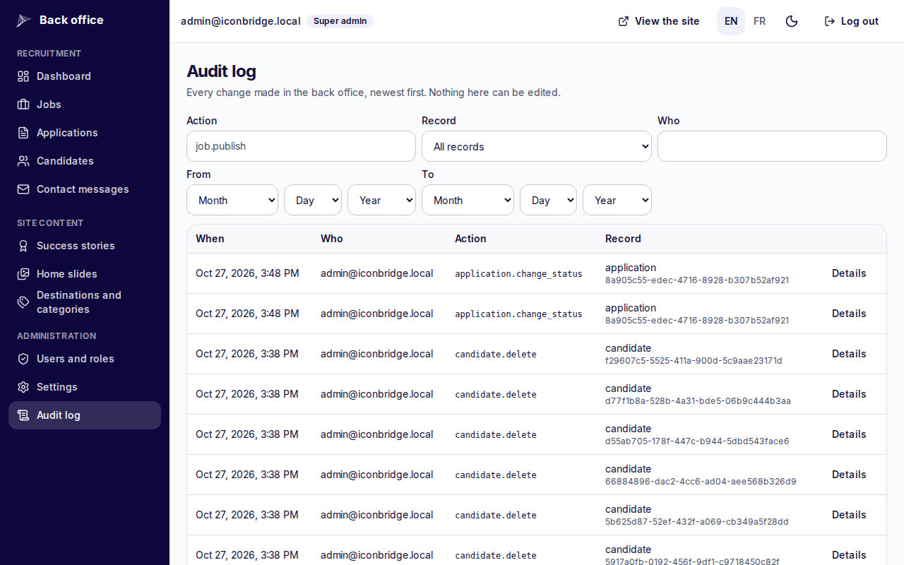

# User guide: back office

How the IconBridge team manages jobs, candidates and the visa pipeline. The back office is at `/en/admin` (or `/fr/admin`), in English and French, after signing in with a back-office account. Operations for the person who runs the platform (deployments, backups, alerts, secrets) are in [RUNBOOK.md](RUNBOOK.md).

Screenshots come from a test environment with sample jobs and a test candidate; no real candidate appears in them.

## Roles

| Role              | Can                                                                                                                                                                                                                                                                                                                                                                        |
| ----------------- | -------------------------------------------------------------------------------------------------------------------------------------------------------------------------------------------------------------------------------------------------------------------------------------------------------------------------------------------------------------------------- |
| **Viewer**        | Read jobs, candidates, applications and documents. No button that writes is shown, and the API refuses writes                                                                                                                                                                                                                                                              |
| **Country agent** | Only the candidates whose **nationality** is one of the agent's countries (not their country of residence): their profile, documents, applications and history; moves applications through the pipeline with a message to the candidate, adds internal notes. Sees nothing else: no jobs, content, exports, settings or users, and the dashboard counts his countries only |
| **Recruiter**     | Everything a viewer can, plus: jobs, application statuses and internal notes, success stories, slides, destinations and categories, exports, revealing a passport number                                                                                                                                                                                                   |
| **Super admin**   | Everything, plus: users and roles, settings, audit log, historical results, full passport numbers in exports, lifting a waiting period, deleting records                                                                                                                                                                                                                   |

Deleting a candidate or an application is for super admins, and for recruiters only when the setting `ALLOW_RECRUITER_DELETE` is on (off by default). Accounts are created by a super admin (**Users and roles** → **Invite a user**): there is no public sign-up for staff.

## Dashboard

Open jobs, new applications of the week, applications in visa processing, visas approved this year, then the results: visas approved, candidates deployed, candidates, partner companies, countries, with charts per year and per destination. **Including history** adds the figures from before the platform (entered by a super admin in **Settings** → historical results); **Platform only** shows live data alone.

## Jobs

The list filters by status, destination and category and shows hired / positions, the number of applications and the deadline. Per job: **Publish** / **Close** / **Reopen**, edit, duplicate, feature (star, shown first on the site), delete (refused once it has applications: close it instead).

**New job**: title, destination, category, employer (shown or not), description, requirements and benefits (rich text editor: bold, italic, lists, headings; anything else is removed), positions and deadline, salary range, currency and period, contract length, working hours, required languages, accommodation and transport, a cover image (checked and re-encoded), and optional **questions** for the candidates (text, yes/no, choice). **Preview** shows the public page before publishing.

A published job leaves the site by itself when its deadline passes or every position is filled. Publishing a job sends it to the people whose job alerts match it.

## Applications

The table lists every application with its candidate, job, date and status; filters by status and destination, and a search on name or email. The **Board** shows one column per status; dragging a card moves the application.

Opening an application shows its panel:

- **Status**: only the next step of the pipeline, or **Reject**, is offered (Submitted → Under review → Shortlisted → Interview → Job offer → Contract signed → Visa in progress → Visa approved → Deployed). Rejected and Withdrawn are final unless a super admin reopens them. **Deployed** takes one position of the job.
- **Message to the candidate** appears in the candidate's timeline and in the email sent at each change. **Internal comment** stays inside the team; candidates never see it.
- **Undo**: the author of a change can take it back within 15 minutes (a correction email follows if the first one was sent).
- **Profile when applying**: a snapshot of the profile at the time of applying, passport masked.
- Documents sent (preview in the browser, download), the cover letter and the answers to the job's questions, the history of statuses, and **internal notes**.
- **Create a success story** once the visa is approved.
- **Lift the waiting period** (super admin): for a deployed, rejected or withdrawn application, so the candidate can apply to the same job again before 6 months; a reason is required and kept in the audit log; nothing is sent to the candidate.

Several applications can be selected for a common status change or deletion; each one gets its own email and audit entry.

**Export** writes the selected or filtered applications to CSV or Excel with the chosen columns. Passport numbers are masked unless a super admin ticks **Full passport number**; every export is logged, and spreadsheet formulas are neutralised.

## Candidates

The candidate page shows the profile, the documents and the applications. **Show** reveals the passport number (recruiters and super admins; each reveal is in the audit log). Document downloads from the back office are logged too. **Disable the account** blocks sign-in; **Delete the candidate** removes the files from storage and erases the personal data, keeping anonymous rows so the figures stay right (a reason and the word DELETE are required).

## Site content

- **Success stories**: photo, text, destination; a story can be published only with the signed consent document of the person, and the public name is shortened. "What the candidate says" is optional: leave the three languages empty and the site shows the story without a quote.
- **Home slides**: image, title and text of the slider, in order (drag to reorder).
- **Destinations and categories**: the lists used by jobs, filters and alerts; a category's icon is a name (`hard-hat`, `ship`, …) or an emoji.

- **Contact messages**: messages of the contact form; a super admin can delete them.

Changes appear on the public site at once.

## Settings (super admin)

Rules applied by the API at once: months before applying again to the same job (6), applications in progress per candidate (5), largest upload (5 MB). Contact details shown on the site (email, phone, WhatsApp, address, social links). Historical results: figures from before the platform, per year and destination. Each change is written to the audit log.

## Users and roles (super admin)

**Invite a user** either sends a set-password link (the person chooses the password) or, with **Set the password now**, creates the account with a password you give the person yourself: it is not shown again, and the person must choose a new one at the first sign-in before doing anything else. **Set a password** does the same for an existing account (it signs it out everywhere). The role can be changed, the account disabled or signed out everywhere. The last super admin cannot be disabled or demoted.

**Country agents**: choose the role **Country agent**, then one or more countries (the nationality of the candidates he follows). The countries column shows them; click it to change them. Agents use an address on the domain (`bihi@iconbridgerecruitment.com`, `majdi@iconbridgerecruitment.com`), which Cloudflare forwards to their inbox (DEPLOYMENT.md, "Mail for agent addresses").

**My password** (top bar): every back-office user changes his own password there.

## Audit log (super admin)

Every change made in the back office, newest first, with who, when, the action and the record; **Details** shows the values before and after (passport numbers masked). Filters: action (for example `application.waive_cooldown`), record type, person and dates. Nothing in it can be edited.
