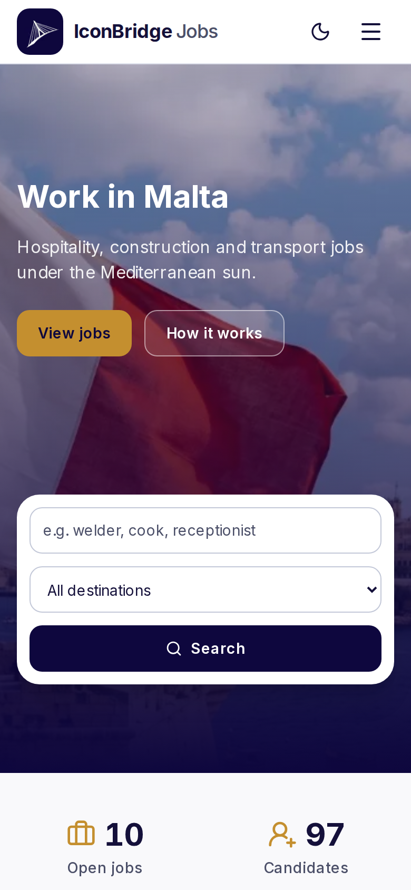
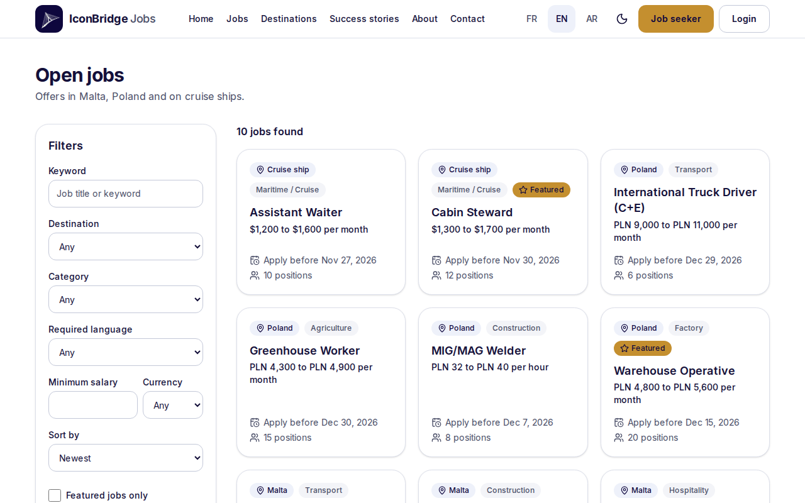
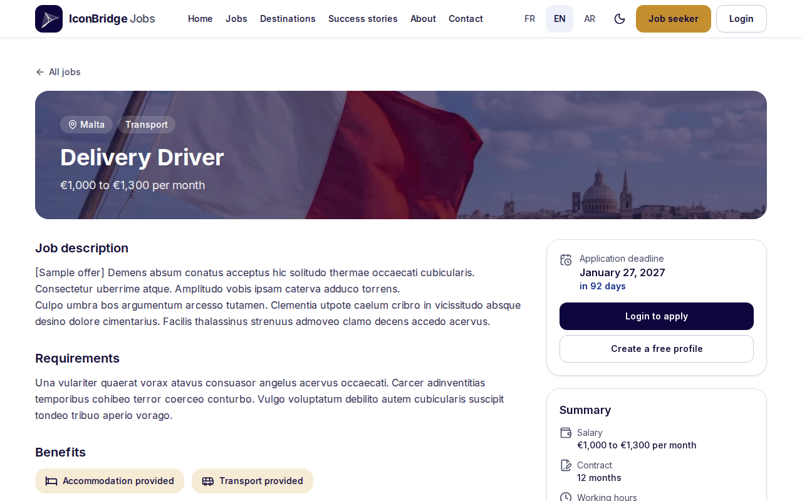
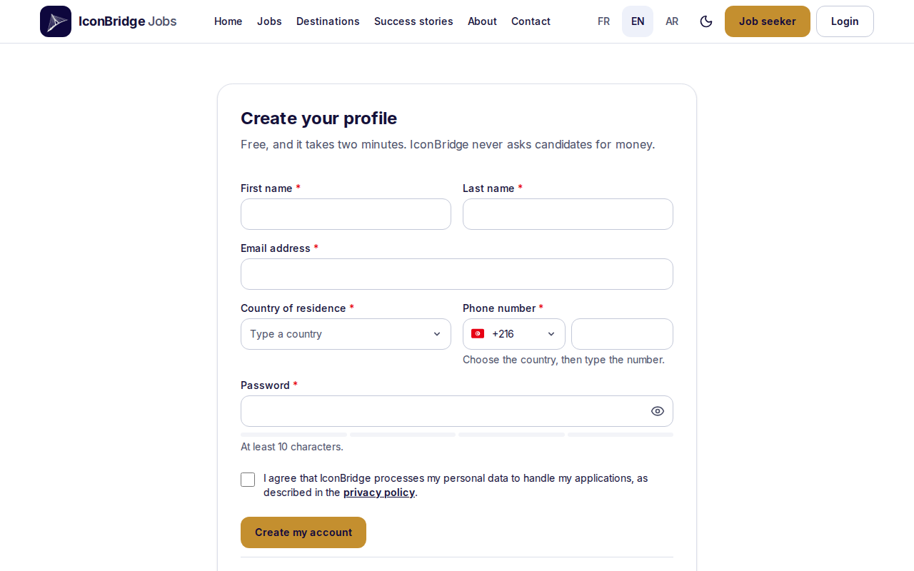
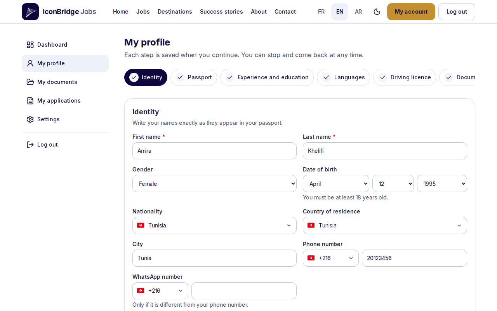
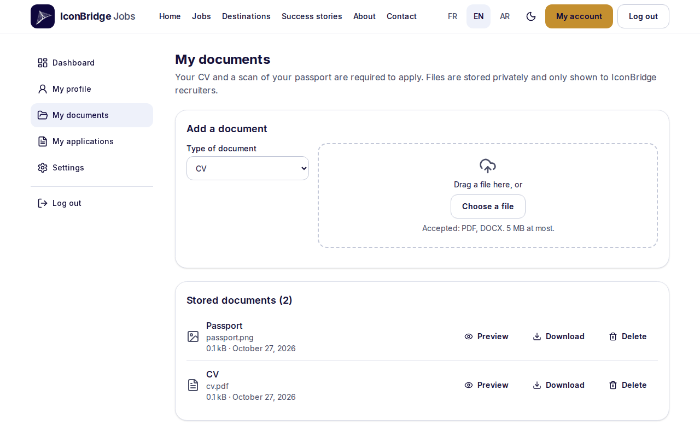
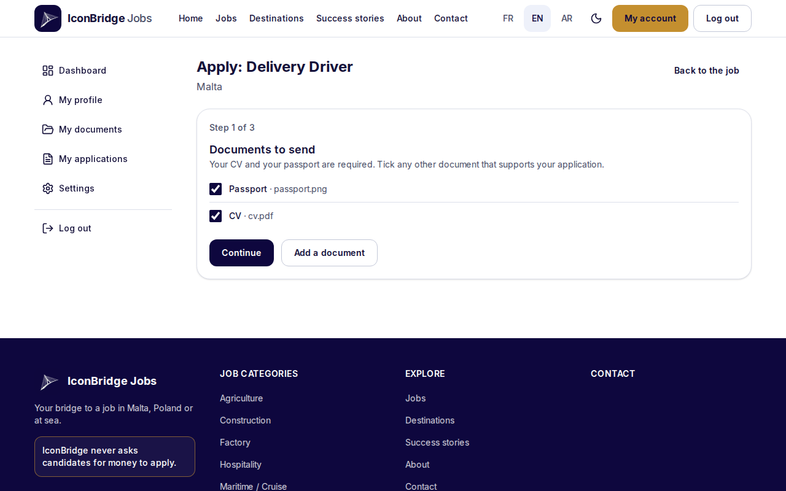
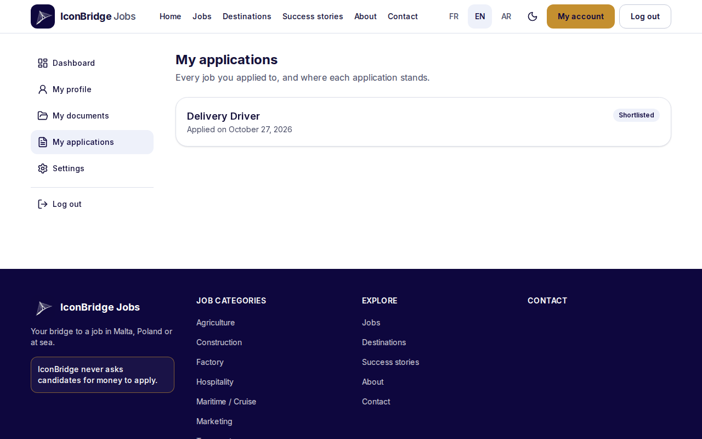

# User guide: candidates

How a person looking for work in Malta, Poland or on a cruise ship uses IconBridge Jobs. The site is in English, French and Arabic (right to left); the language switch is at the top of every page and the emails follow the language chosen in the settings.

Screenshots come from a test environment with sample jobs and a test account; no real candidate appears in them. IconBridge never asks candidates for money.

## 1. Find a job

The home page searches by keyword and destination, shows the counters (open jobs, candidates, visas, partners), the destinations, the latest jobs and success stories. It works on a phone too:

**Jobs** lists the open offers. Filters: keyword, destination, category, required language, minimum salary and currency, featured jobs; they stay in the address, so a search can be shared.

A job page gives the description, the requirements, the benefits (accommodation, transport, …), the salary, the contract, the deadline and the number of positions. A visitor sees **Login to apply** and **Create a free profile**.

Without an account, **job alerts** (bottom of the home page) send an email when a matching job is published; the address must be confirmed through the link received, and every alert email has an unsubscribe link.

## 2. Create an account

**Job seeker** → **Create your profile**: first and last name, email, country of residence, phone number with its country code, a password of 10 characters or more, and consent to the processing of personal data (privacy policy). A short anti-robot check protects the form.

An email with a confirmation link follows. Applying and job alerts need a confirmed address; the link can be sent again from the account. A forgotten password is replaced with **Forgot password** on the sign-in page (link valid for a limited time). For safety, the site answers the same whether or not an address has an account.

## 3. Build the profile

**My account** → **My profile** is a wizard; each step is saved on **Continue**, and the candidate can stop and come back.

| Step                     | Content                                                                                                                               |
| ------------------------ | ------------------------------------------------------------------------------------------------------------------------------------- |
| Identity                 | Names as in the passport, gender, date of birth (18 or older), nationality, country of residence, city, phone, WhatsApp               |
| Passport                 | Number, issuing country, issue and expiry dates. A passport expiring in less than 6 months is flagged; an expired one blocks applying |
| Experience and education | Current profession, years of experience, education level                                                                              |
| Languages                | Languages spoken and level (A1 to C2, native)                                                                                         |
| Driving licence          | Categories held                                                                                                                       |
| Cruise ships             | STCW training, seaman's book, medical certificate, sea experience (for cruise jobs)                                                   |
| Documents                | What is still missing to apply                                                                                                        |

The passport number is encrypted; recruiters see it masked (`*****567`) unless they reveal it, and every reveal is recorded.

## 4. Upload documents

**My documents**: choose the type, then drag a file or **Choose a file**.

| Type                                                                | Formats        |
| ------------------------------------------------------------------- | -------------- |
| CV                                                                  | PDF, DOCX      |
| Photo                                                               | JPEG, PNG      |
| Passport, diploma, certificate, STCW, seaman's book, medical, other | PDF, JPEG, PNG |

The size limit is shown on the page (5 MB by default); 30 documents at most. The site checks the real content of the file, not its name, and stores it privately: only the candidate and IconBridge recruiters can open it, through links valid 5 minutes. A document attached to an application cannot be deleted while the application is in progress.

## 5. Apply

**Apply** on a job page opens three steps:

1. **Documents to send**: the CV and a passport scan are required; other documents can be ticked.
2. **Cover letter and questions**: an optional letter, and the job's own questions if it has any.
3. **Check before sending**, then **Send my application**.

When applying is not possible, the page says why instead:

| Message                                         | Rule                                                                                      |
| ----------------------------------------------- | ----------------------------------------------------------------------------------------- |
| Confirm your email address first                | The address of the account is not confirmed                                               |
| Complete these items of your profile            | Required profile items or documents are missing (listed)                                  |
| Your passport has expired                       | Enter a valid passport                                                                    |
| You applied to this job on … / again from …     | **One application per job every 6 months**, whatever became of the previous one (setting) |
| Number of applications allowed at the same time | 5 applications in progress at most (setting): wait for an answer or withdraw one          |
| This job is no longer open                      | Deadline passed, positions filled, or job closed                                          |

## 6. Follow the application

**My applications** lists every application and its status; each change also sends an email.

An application shows its progress through the visa pipeline: Submitted → Under review → Shortlisted → Interview → Job offer → Contract signed → Visa in progress → Visa approved → Deployed (or Rejected). Messages written by the recruiter for the candidate appear under the step; internal notes of the agency never do.

**Withdraw my application** stops an application in progress.

## 7. Settings and personal data

**Settings**:

- **Language** of the site and of the emails.
- **Password**: changing it signs out the other devices.
- **Job alerts** for chosen destinations and categories (confirmed address needed).
- **Download my data**: one archive with the profile, the documents and the applications.
- **Delete my account**: the profile, the documents and the personal data are erased for good, after typing a confirmation word; applications in progress are withdrawn. The email address becomes free again.

An account without activity (sign-in, application) for 24 months is erased automatically, after a warning email 30 days before; signing in keeps it.
